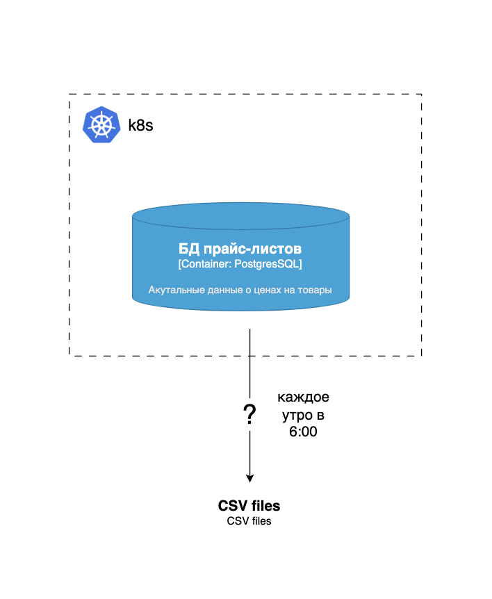
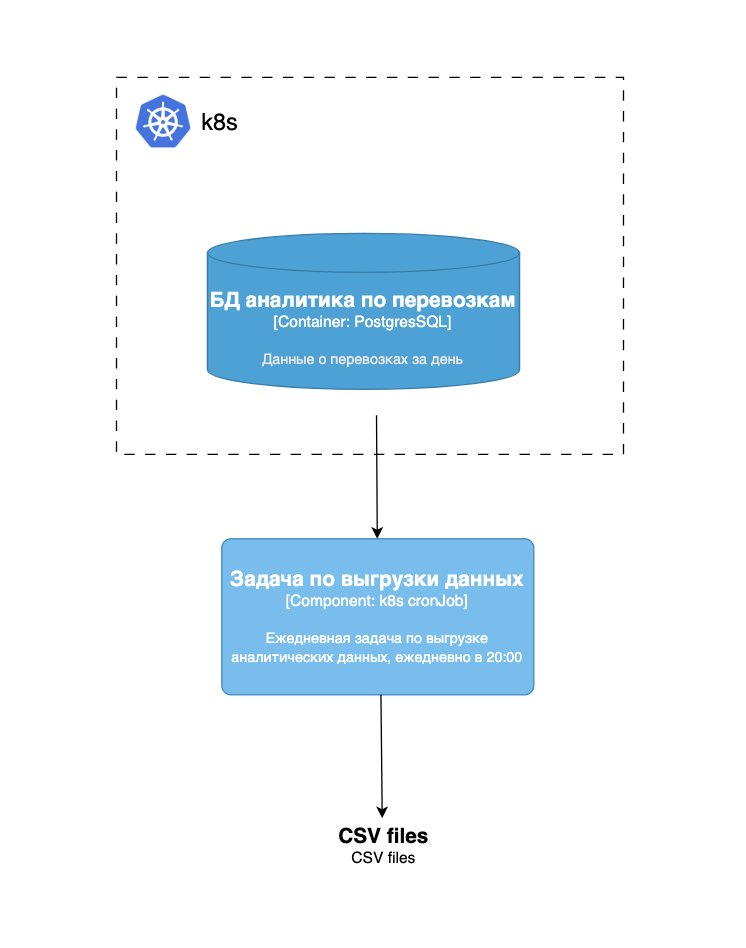

# Проектная работа 5-го спринта

Проект состоит из шести заданий:

- **Часть 1:** три независимых задания.
- **Часть 2:** три связанных задания на основе общего кейса компании TradeWare.

Рекомендуемый порядок выполнения: от Task1 к Task6.

## Краткая карта проекта

| Задание | Тема | Результат | Директория |
| --- | --- | --- | --- |
| Task1 | Выбор решения для пакетной обработки | Обоснование, POC-пайплайн, демонстрация | `task-1/results` |
| Task2 | Дизайн модуля пакетной обработки | Сравнение решений, C4 To Be, план реализации | `task-2/results` |
| Task3 | Distributed Scheduling | Docker-образ, Kubernetes CronJob, демонстрация | `task-3/results` |
| Task4 | ETL на Spring Batch | ADR, C4, работающий ETL, демонстрация | `task-4/results` |
| Task5 | Мониторинг и логирование | Метрики, дашборды, алерты, ELK | `task-5/results` |
| Task6 | Трейсинг | API запуска ETL, клиент, trace-контекст в ELK | `task-6/results` |

## Подготовка

- [ ] Сделать форк [исходного репозитория](https://github.com/Yandex-Practicum/msa-project-5).
- [ ] Выполнять задания в соответствующих директориях `task-N/results`.
- [ ] После выполнения всех заданий создать pull request в основную ветку своего репозитория.
- [ ] Убедиться, что pull request содержит все необходимые изменения.

### Инструменты

- Docker Compose;
- Minikube;
- PostgreSQL;
- ELK, Prometheus и Grafana;
- Draw.io.

## Часть 1. Независимые задания

### Task1. Выбор и реализация решения для пакетной обработки данных

#### Контекст

Маркетинговому отделу нужно объединять данные клиентов из разных источников и формировать отчёты. Источники данных:

- CSV-файлы со статусами доставки;
- PostgreSQL с заказами, платежами и расширенными данными пользователей;
- Kafka с событиями изменения заказов.

Текущая система не справляется с нагрузкой и новым функционалом. Ожидаемый объём данных за один запуск пайплайна — около **1 млн записей**.

Решение должно позволять гибко строить пайплайн, работать с внешними API, BigQuery, Redshift, Kafka и Spark, а также поддерживать мониторинг и оповещения. Его нужно развернуть локально с возможностью последующего переноса в облако.

#### Что нужно сделать

##### 1. Обосновать выбор технологии

- [ ] Описать интеграцию с BigQuery, Redshift, Kafka и Spark.
- [ ] Указать, существуют ли готовые модули для этих интеграций.
- [ ] Проверить поддержку ветвления, условных операторов и event triggers.
- [ ] Проверить наличие fallback logic, retry и email-уведомлений из коробки.
- [ ] Обосновать способ развёртывания решения в облаке.

##### 2. Реализовать POC

- [ ] Развернуть выбранное решение локально.
- [ ] Реализовать чтение данных из БД или файловой системы.
- [ ] Добавить анализ данных и условное ветвление пайплайна.
- [ ] Настроить email-уведомления об успешном и неуспешном завершении.
- [ ] Настроить retry-политику для шагов пайплайна.
- [ ] Записать скринкаст или сделать скриншоты работы решения.

#### Результат

В `task-1/results` должны находиться:

- обоснование выбранного решения;
- код и конфигурация пайплайна;
- скринкаст или скриншоты локального запуска.

### Task2. Разработка дизайна модуля пакетной обработки данных

#### Контекст

Каждое утро в **06:00** онлайн-магазин должен формировать индивидуальные CSV/XLS-прайс-листы для B2B-клиентов на основе данных PostgreSQL. Дополнительная обработка данных не требуется.

| Таблица | Объём |
| --- | ---: |
| `products` | 5 000–10 000 строк |
| `categories` | 50–200 строк |
| `clients` | 100–500 строк |
| `client_prices` | 10 000–20 000 строк |

Данные нужно связать и выгрузить в CSV. Размер итоговой выгрузки — **5 000–10 000 строк**. Инфраструктура магазина состоит из облачных микросервисов.

#### Текущее состояние (As Is)

#### Что нужно сделать

##### 1. Выбрать технологию

Сравнить Spring Batch, Apache Airflow, Kubernetes Job и Spark.

| Критерий | Spring Batch | Apache Airflow | K8s Job | Spark |
| --- | --- | --- | --- | --- |
| Наличие CRON-расписания |  |  |  |  |
| Сложность реализации логики обработки |  |  |  |  |
| Потребление ресурсов |  |  |  |  |
| Масштабируемость и сложность её реализации |  |  |  |  |
| Развёртывание в облаке и интеграция с микросервисами |  |  |  |  |
| Интеграция с логированием и мониторингом |  |  |  |  |

- [ ] Заполнить таблицу сравнения.
- [ ] Сформулировать вывод и обосновать выбор.

##### 2. Спроектировать решение

- [ ] Создать контекстную C4-диаграмму состояния To Be.
- [ ] Описать работу решения.
- [ ] Подготовить верхнеуровневый пошаговый план конфигурации и реализации.

#### Результат

В `task-2/results` должны находиться:

- заполненная таблица сравнения и выводы;
- C4-диаграмма To Be;
- верхнеуровневый план конфигурации и реализации.

### Task3. Реализация Distributed Scheduling с Kubernetes CronJob

#### Контекст

Платформа грузоперевозок должна ежедневно в **20:00** выгружать данные в хранилище аналитиков. На их основе обновляются дашборды дневной отчётности. Для запуска выбран Kubernetes CronJob.

| Таблица | Ежедневный объём |
| --- | ---: |
| `shipments` | 50 000–200 000 строк |
| `shipment_events` | 500 000–1 000 000 строк |
| `drivers` | 1 000–5 000 строк |
| `vehicles` | 500–2 000 строк |
| `clients` | 10 000–50 000 строк |

#### Целевое состояние (To Be)

#### Что нужно сделать

- [ ] Реализовать на удобном языке простой экспорт одной таблицы из БД.
- [ ] Подготовить конфигурацию сборки Docker-образа.
- [ ] Подготовить YAML-конфигурацию Kubernetes CronJob с расписанием на 20:00.
- [ ] Запустить CronJob в Minikube.
- [ ] Записать видео или сделать скриншоты работающей задачи.

#### Результат

В `task-3/results` должны находиться:

- код экспорта данных;
- файлы для сборки Docker-образа;
- YAML-файлы Kubernetes CronJob;
- видео или скриншоты работы CronJob в Minikube.

## Часть 2. Кейс TradeWare

Задания Task4–Task6 связаны между собой. В Task5 используется приложение из Task4, а в Task6 оно дорабатывается ещё раз.

### Компания

TradeWare предоставляет малому и среднему бизнесу складские решения для хранения стройматериалов: API для интеграции со складскими системами и управления товарными остатками.

#### Проблемы

- В пиковые периоды отчёты по остаткам зависают.
- Позиции обновляются с большой задержкой или не обновляются.
- ERP-интерфейс замедляется при создании складских заданий и приёмке материалов.
- Централизованные мониторинг, метрики и логирование отсутствуют.
- Доступны только файловые логи и стандартный мониторинг VM и WildFly.
- Монолит одновременно обслуживает пользовательский интерфейс и обрабатывает загружаемые отчёты.

#### Нагрузка

Обычная максимальная нагрузка — около **400 000 строк в сутки**. В пиковые дни она возрастает в **2–3 раза**.

Во время загрузки отчёта система выполняет:

1. Валидацию формата и целостности данных.
2. Обогащение позиций справочными данными, включая изменения на складах и промоакции.
3. Запись обновлённых данных в результирующую таблицу.

При низкой нагрузке система работает стабильно. Основная проблема — инфраструктура не адаптируется к резкому росту нагрузки и объёма данных.

#### Текущая миграция

TradeWare начала переход к микросервисной архитектуре:

- монолитную БД перенесли в Google Cloud Platform;
- файлы отчётов перенесли в Google Cloud Storage.

Пакетная обработка пока отсутствует. Каждая запись обрабатывается отдельно в онлайн-режиме, поэтому:

- построчные обновления перегружают транзакционные ресурсы БД;
- отчётность формируется в реальном времени вместо ночной пакетной обработки;
- API партнёров и складов задерживают и блокируют друг друга;
- причины ошибок сложно найти по разрозненным логам и метрикам.

#### Структура компании

- команды frontend-, backend-разработки и DevOps;
- отдел складской логистики;
- отдел по работе с партнёрами;
- отдел продаж;
- отдел аналитики и отчётности;
- служба поддержки клиентов и партнёров.

#### Продукты

- **Монолитное Java-приложение:** показывает остатки, обрабатывает перемещения и формирует внутренние и партнёрские отчёты.
- **Сервис учёта хранения и логистики:** формирует отчёты о движении товаров и выгружает CSV после перемещения.
- **Frontend-приложение:** интерфейс сотрудников склада и менеджеров с остатками, историей перемещений и аналитикой.

#### Технологический стек

| Область | Технологии |
| --- | --- |
| Backend | Java 11, WildFly, PostgreSQL, GCS |
| Frontend | Angular, WebSockets |
| DevOps | Docker, Docker Compose, GCP |

#### Текущий сценарий обработки отчёта

[Исходный файл диаграммы `case_diagram_1.drawio`](https://code.s3.yandex.net/microservice-architecture/%D0%A1%D0%BF%D1%80%D0%B8%D0%BD%D1%823/case_diagram_1.drawio?etag=da92bfe442fe5b756a47d8b8b2463017)

Порядок обработки:

1. Сотрудник заполняет Excel-шаблон и сохраняет отчёт как CSV. Первичная проверка формата выполняется средствами шаблона.
2. Сотрудник загружает CSV через ERP-интерфейс.
3. Java-приложение повторно проверяет файл. При ошибке браузер показывает сообщение «Ошибка формата загружаемых данных».
4. Валидный файл сохраняется в GCS.
5. Приложение обогащает данные справочной информацией из БД и записывает результат в БД номенклатуры.
6. После успешной обработки сотрудник получает уведомление.
7. При ошибке сотрудник исправляет отчёт и загружает его повторно.

#### Ожидаемый рост

После рекламной кампании компания ожидает рост числа пользователей, заявок на хранение, товарной номенклатуры и объёма данных о движении и остатках. Появятся дополнительные источники данных. Поэтому нужны гибкие пайплайны и retry-механизмы.

#### Цели бизнеса

- Подготовить систему к росту объёма данных.
- Поддержать **100–150 параллельных загрузок** в пиковые часы.
- Обеспечить гибкое масштабирование.
- Обрабатывать отчёт из **2 000 строк не дольше 30 секунд в среднем**.
- Внедрить централизованный сбор логов и метрик.
- Подготовить постепенный переход от монолита к микросервисам.
- Сохранить удобную интеграцию с Java-экосистемой, мониторингом и логированием.

### Task4. Реализация ETL с использованием Spring Batch

#### Контекст

Инжиниринг-лид предложил Spring Batch, потому что уже работал с ним. Нужно проверить, подходит ли технология для TradeWare, предложить альтернативы и реализовать локальный POC, который позднее можно перенести в облако.

#### Что нужно сделать

##### 1. Спроектировать архитектуру

- [ ] Проанализировать проблемы кейса.
- [ ] Описать архитектурное решение для ETL и хранения данных на Spring Batch.
- [ ] Оформить решение как ADR по [шаблону](https://code.s3.yandex.net/microservice-architecture/%D0%A1%D0%BF%D1%80%D0%B8%D0%BD%D1%823/ADR1.md?etag=f24e2159b642a2638f4fc502424b5b4f).
- [ ] Предложить альтернативы Spring Batch.
- [ ] Создать C4-диаграмму с компонентом Spring Batch.

##### 2. Реализовать ETL-приложение

Spring Batch должен:

1. Прочитать товары из `product-data.csv`.
2. Обогатить их данными программы лояльности из таблицы `loyality_data`.
3. Записать обновлённые данные в таблицу `products` PostgreSQL.

Часть исходных файлов доступна в [шаблоне Task4](https://github.com/Yandex-Practicum/msa-project-5/tree/main/task-4/initial).

- [ ] Доработать шаблон Java-приложения.
- [ ] Подготовить CSV-файлы.
- [ ] Настроить PostgreSQL в Docker Compose.
- [ ] Создать таблицы с помощью `schema-all.sql`.
- [ ] Запустить решение через Docker Compose.
- [ ] Продемонстрировать логи и обновлённые данные таблицы `products`.
- [ ] Записать видео или сделать скриншоты.

#### Результат

В `task-4/results` должны находиться:

- ADR с обоснованием решения и альтернативами;
- C4-диаграмма со Spring Batch;
- Docker Compose;
- доработанный Java-проект;
- CSV-файлы и необходимые SQL-скрипты;
- видео или скриншоты работы решения.

### Task5. Мониторинг, оповещения и логирование

#### Контекст

Нужно спроектировать и локально развернуть мониторинг, оповещения и централизованное логирование для Spring Batch-приложения из Task4. Решение должно подходить для последующего использования в облаке.

Для старта можно использовать [шаблоны Task5](https://github.com/Yandex-Practicum/msa-project-5/tree/main/task-5).

#### Что нужно сделать

##### 1. Спроектировать решение

- [ ] Выбрать ключевые метрики приложения и обосновать выбор.
- [ ] Определить необходимые данные логов.
- [ ] Обосновать способ отправки логов.
- [ ] Выбрать способ настройки оповещений и обосновать его.
- [ ] Дополнить C4-диаграмму мониторингом, логированием и оповещениями.

##### 2. Реализовать решение

- [ ] Развернуть через Docker Compose Prometheus, Grafana и ELK.
- [ ] Настроить отправку метрик через Prometheus Agent или JMX Exporter.
- [ ] Добавить логирование операций Spring Batch.
- [ ] Настроить отправку логов в Elasticsearch через Filebeat.
- [ ] Создать Grafana-дашборды с метриками приложения.
- [ ] Настроить оповещения по одной или двум метрикам в Grafana или Prometheus.
- [ ] Продемонстрировать централизованные логи в Kibana.

#### Результат

В `task-5/results` должны находиться:

- дополненная C4-диаграмма;
- обоснование выбора метрик;
- обоснование логирования и конфигурации оповещений;
- Spring Batch-приложение с метриками и логами;
- Docker Compose с Prometheus, Grafana и ELK;
- конфигурация Filebeat и сбор логов в ELK;
- Grafana-дашборды;
- конфигурация одного или двух оповещений;
- демонстрация работы решения.

### Task6. Настройка трейсинга

#### Контекст

Spring Batch-приложение больше не должно запускать ETL-задачу при старте. Запуск должен происходить по API-вызову. Отдельный клиент на любом удобном языке вызывает этот API.

Основной акцент задания — трейсинг запросов в логах. Контекст каждого вызова должен содержать:

- `traceId`;
- `spanId`;
- `URI`.

#### Что нужно сделать

- [ ] Добавить endpoint для запуска ETL-задачи.
- [ ] Отключить автоматический запуск задачи при старте приложения.
- [ ] Реализовать простой клиент, вызывающий endpoint.
- [ ] Выбрать и обосновать решение для трейсинга.
- [ ] Добавить `traceId`, `spanId` и `URI` в логи запроса.
- [ ] Отправить логи в ELK.
- [ ] Продемонстрировать trace-контекст в ELK.

#### Результат

В `task-6/results` должны находиться:

- доработанное Spring Batch-приложение с API;
- клиент для запуска ETL;
- конфигурация трейсинга и логирования;
- скриншоты или видео с отображением логов в ELK.

## Финальная проверка перед сдачей

- [ ] Все результаты находятся в директориях `task-1/results` — `task-6/results`.
- [ ] В pull request включены все необходимые файлы.
- [ ] Репозиторий публичный и доступен ревьюеру.
- [ ] После отправки ссылки на ревью изменения в проект больше не вносятся до ответа ревьюера.

## Исходные материалы

Этот документ подготовлен на основе файлов:

- `tasks.txt`;
- `Яндекс Практикум.html`;
- `Яндекс Практикум.mhtml`.

Встроенные в сохранённую страницу диаграммы извлечены в директорию `images`.
