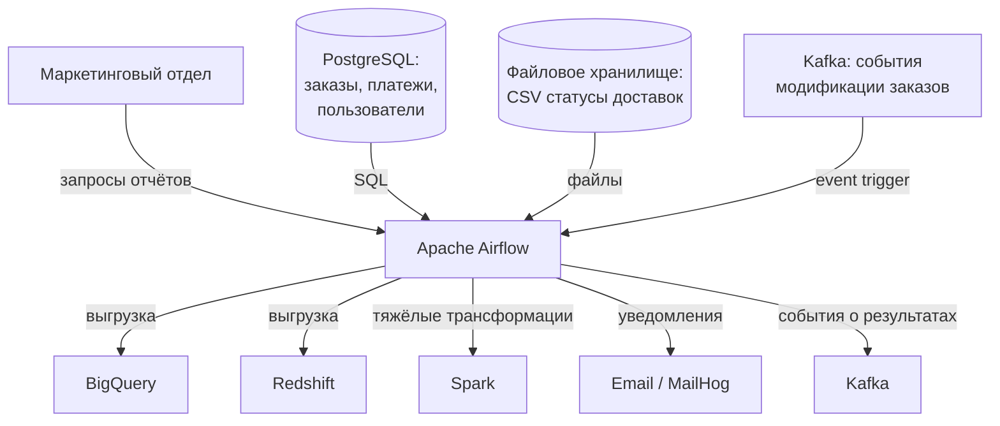
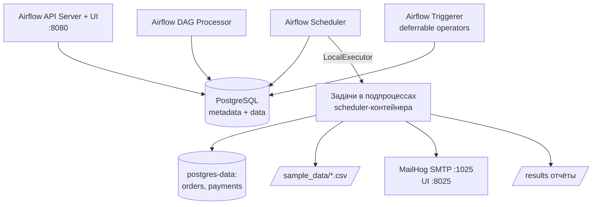
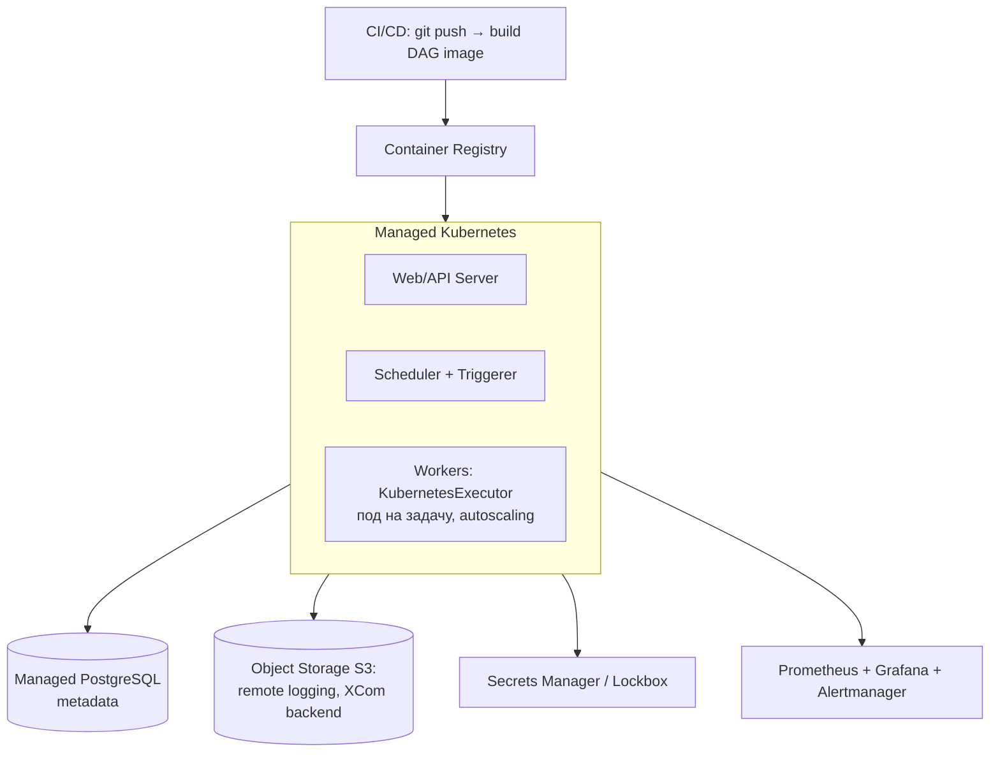

# ADR-001: Выбор и реализация решения для пакетной обработки данных маркетингового отдела

### **Автор:**
Александр Никитин

### **Дата:**
2026-08-03

### **Статус:**
Accepted

---

## Функциональные требования

|**№**|**Действующие лица или системы**|**Use Case**|**Описание**|
| :-: | :- | :- | :- |
|1|Маркетинговый отдел|Консолидация данных клиентов|Объединение данных из разнородных источников: CSV-файлы со статусами доставок, таблицы PostgreSQL (заказы, платежи, расширенные данные пользователей), события модификации заказов из Kafka|
|2|Маркетинговый отдел|Формирование отчётов|Построение сводных отчётов по объединённым данным с разбивкой по категориям и сегментам|
|3|Аналитическая платформа|Интеграция с DWH|Выгрузка результатов в BigQuery / Redshift, запуск тяжёлых трансформаций на Spark|
|4|Система событий|Event-driven интеграция|Запуск пайплайнов по событиям (Kafka, появление файлов), публикация событий о результатах|
|5|Дежурный инженер|Мониторинг и оповещения|Email-уведомления об успехе/ошибке, веб-интерфейс мониторинга, retry и fallback при сбоях|

## Нефункциональные требования

|**№**|**Требование**|
| :-: | :- |
|1|Обработка ~1 млн записей за один запуск пайплайна|
|2|Гибкое конструирование пайплайнов: ветвления, условные операторы, event-triggers|
|3|Готовые модули интеграции с внешними API, BigQuery, Redshift, Kafka, Spark|
|4|Retry-политики, fallback-логика и email-уведомления «из коробки»|
|5|Горизонтальное масштабирование воркеров|
|6|Встроенный мониторинг и логирование|
|7|Развёртывание в облачной среде (в т.ч. managed-варианты)|

---

## Решение

### Выбранное решение: **Apache Airflow 3**

### Диаграмма контекста

### Диаграмма контейнеров (локальное развёртывание POC)

### Обоснование выбора

1. **Экосистема провайдеров** — официальные пакеты `apache-airflow-providers-*` закрывают все требуемые интеграции готовыми операторами (см. раздел «Интеграции»). Таким образом разработка сводится к конфигурированию, а не к написанию коннекторов.
2. **Пайплайн как код (Python)** — маркетинговые пайплайны меняются часто; декларативный TaskFlow API позволяет аналитикам с базовым Python собирать пайплайны из функций.
3. **Встроенные надёжность и наблюдаемость** — retry/backoff, SLA, уведомления, UI с Gantt/Graph/логами, метрики (StatsD/Prometheus), REST API — всё «из коробки».
4. **Масштабирование** — CeleryExecutor / KubernetesExecutor + dynamic task mapping покрывают рост до 1 млн записей и выше; тяжёлые объёмы выносятся в Spark (Airflow остаётся оркестратором, не движком обработки).
5. **Облачная готовность** — официальный Helm-чарт, managed-сервисы (AWS MWAA, Google Cloud Composer, Astro), контейнерный деплой в любой Kubernetes.

#### Интеграция с BigQuery, Redshift, Kafka, Spark — готовые модули

Для **всех** требуемых систем существуют официальные провайдер-пакеты с готовыми операторами, хуками и трансферами — писать интеграционный код не нужно:

| Система | Пакет | Готовые модули (примеры) |
|---|---|---|
| **BigQuery** | `apache-airflow-providers-google` | `BigQueryInsertJobOperator`, `BigQueryExecuteQueryOperator`, `GCSToBigQueryOperator`, `BigQueryToGCSOperator`, `BigQueryHook` |
| **Redshift** | `apache-airflow-providers-amazon` | `RedshiftDataOperator`, `RedshiftSQLOperator`, `S3ToRedshiftOperator`, `RedshiftToS3Operator`, `RedshiftHook` |
| **Kafka** | `apache-airflow-providers-apache-kafka` | `KafkaProduceOperator`, `AwaitMessageTriggerFunctionSensor`, хуки `KafkaProducerHook`/`KafkaConsumerHook` |
| **Spark** | `apache-airflow-providers-apache-spark` + `apache-airflow-providers-apache-livy` | `SparkSubmitOperator`, `SparkJDBCOperator`, `LivyOperator`, `KubernetesPodOperator`/`SparkKubernetesOperator` для Spark-on-K8s |
| **PostgreSQL** | `apache-airflow-providers-postgres` | `PostgresOperator`, `PostgresHook`, `SQLExecuteQueryOperator` |
| **Внешние API** | `apache-airflow-providers-http` | `HttpOperator`, `HttpHook`, `HttpSensor`; плюс Python-библиотеки в `@task` |

Установка — одна строка в образе/requirements: `pip install apache-airflow-providers-google apache-airflow-providers-amazon apache-airflow-providers-apache-kafka apache-airflow-providers-apache-spark`.

**Вывод:** готовые модули есть для всех четырёх систем, они существенно ускорят разработку.

#### Ветвление, условные операторы, event-triggers

Всё поддерживается нативно:

- **Ветвление:** `BranchPythonOperator` / декоратор `@task.branch` — выбор следующей ветки по результату анализа.
- **Условные операторы:** `ShortCircuitOperator` / `@task.short_circuit` (пропуск остатка пайплайна), `LatestOnlyOperator`, а также **Trigger Rules** (`all_success`, `all_failed`, `one_failed`, `none_failed_min_one_success`, `all_done`) для управления запуском задач по итогам апстримов.
- **Event-triggers:**
  - **Sensors** (`FileSensor`, `S3KeySensor`, `HttpSensor`) — **deferrable-режим** (задача «паркуется» в triggerer и не занимает слот воркера, пока ждёт событие);
  - **Data-aware scheduling (Assets/Datasets)** — DAG запускается событием «обновился датасет, который другой DAG пометил как outlet». В POC реализовано: `marketing_report_publisher` автоматически стартует после обновления asset'а `marketing_orders_mart` первым DAG'ом;
  - Внешний запуск через **REST API** (`POST /dags/{id}/dagRuns`) — из любого событийного контура.

#### 3. Fallback-logic, retry, email-уведомления из коробки

- **Retry:** параметры задач `retries`, `retry_delay`, `retry_exponential_backoff`, `max_retry_delay` — декларативно, без кода. В POC: экспоненциальный backoff (1 мин → 2 мин → 4 мин) на задачах чтения.
- **Fallback-logic:**
  - задача-компенсация с `trigger_rule=TriggerRule.ALL_FAILED` (в POC: `quarantine_failed_batch` — складывает «отравленный» батч в карантинную зону и поднимает алерт);
  - `on_failure_callback` / `on_retry_callback` на уровне задачи и всего DAG;
  - идемпотентность и перезапуск любого подграфа из UI (`clear`/`retry` с partial re-run).
- **Email из коробки:** глобальная настройка SMTP (`AIRFLOW__SMTP__*`) + флаги `email_on_failure`, `email_on_retry` и список `email` в задаче — Airflow сам шлёт письма об ошибках и повторных попытках со ссылкой на лог. Уведомление об успехе — через **Notifier-фреймворк** (`send_smtp_notification` в `on_success_callback`) или `EmailOperator`; аналогично подключаются Slack/Teams-нотификаторы. В POC почта ловится MailHog'ом (SMTP :1025, UI :8025) — никакого самописного SMTP-кода в DAG'е нет.

#### 4. Развёртывание в облачной среде

Целевая облачная архитектура (production):

- **Базовый вариант (vendor-neutral):** официальный Helm-чарт `apache-airflow/airflow` в Managed Kubernetes (Yandex Managed Service for Kubernetes / EKS / GKE). Executor — **KubernetesExecutor** (под на задачу, автоскейлинг по нодам) или CeleryKubernetesExecutor для смешанных нагрузок. Метаданные — **Managed PostgreSQL** (HA, бэкапы из коробки). Логи — **remote logging в Object Storage (S3)**, секреты — в Vault/Lockbox/Secrets Manager через secrets backend. Наблюдаемость — метрики Airflow в Prometheus, дашборды Grafana, алерты в дополнение к email.
- **Managed-варианты (минимум эксплуатации):** AWS MWAA, Google Cloud Composer, Astro — те же DAG'и без изменений, инфраструктура управляется провайдером.
- **Доставка DAG'ов:** CI/CD — сборка образа с DAG'ами или git-sync/S3-sync в поды; миграция метаданных — через `airflow db migrate` в init-контейнере.
- **1 млн записей:** обработка чанками + dynamic task mapping по партициям; тяжёлые джойны/агрегации выносятся в Spark (EMR/Dataproc/Data Proc) через `SparkSubmitOperator`/`LivyOperator`, Airflow остаётся тонким оркестратором.

---

## Альтернативы

### Spring Batch
- **Плюсы:** зрелая модель chunk-based обработки, транзакционность, высокая производительность на JVM, retry/skip из коробки.
- **Минусы:** это библиотека, а не оркестратор — нет UI мониторинга, расписаний, ветвления уровня DAG, event-triggers «из коробки» (нужны Spring Cloud Data Flow + внешние компоненты); интеграции с BigQuery/Redshift/Kafka/Spark придётся писать руками; привязка к Java-стеку, тогда как data-инженерия компании — Python.
- **Почему отклонён:** закрывает «обработку», но не «оркестрацию и эксплуатацию»; суммарная стоимость владения выше.

### Apache NiFi
- **Плюсы:** визуальный конструктор потоков, back-pressure, много процессоров-коннекторов (Kafka, S3 и др.), хорош для потоковой маршрутизации.
- **Минусы:** пайплайн хранится в UI/XML, а не в коде — слабый code review и CI/CD; сложная условная бизнес-логика и отчётные трансформации выражаются хуже, чем в Python; версионирование и тестирование пайплайнов неудобны.
- **Почему отклонён:** требования «гибко формировать пайплайн кодом» и «условные операторы» решаются в Airflow естественнее.

---

## Недостатки, ограничения, риски выбранного решения

**Недостатки:**
1. Кривая обучения: идиоматичные DAG'и (идемпотентность, правильные trigger rules, шаблоны Jinja) требуют дисциплины.
2. Избыточен для тривиальных «одношаговых» джоб (там проще cron/Cloud Composer-less решение).
3. Требует сопутствующей инфраструктуры: СУБД метаданных, (при Celery) брокер, мониторинг.

**Ограничения:**
1. Airflow — оркестратор, а не движок обработки: перенос 1 млн строк «через XCom» — анти-паттерн; данные должны идти через хранилища/Spark.
2. SequentialExecutor/LocalExecutor не масштабируются горизонтально — для прода обязателен Celery/KubernetesExecutor.
3. Веб-сервер и планировщик — критичные компоненты; без HA-настройки это единые точки отказа.

**Риски и меры:**
1. *Сложность эксплуатации кластера* → managed-сервис (MWAA/Composer) или Helm-чарт с выверенными values; инфраструктура как код (Terraform).
2. *Деградация на больших объёмах* → чанкинг, dynamic task mapping, вынос тяжёлых трансформаций в Spark, ресурсные лимиты и пулы (`pools`) для защиты источников.
3. *Сбои внешних источников* → retry с экспоненциальным backoff, deferrable-сценсоры вместо занятых слотов, fallback в quarantine, мониторинг SLA-мisses.
4. *Неконтролируемый рост DAG'ов* → code review DAG'ов, тесты DAG'ов в CI (`airflow dags test`, unit-тесты на ветвление), conventions по naming/tags/owners.
