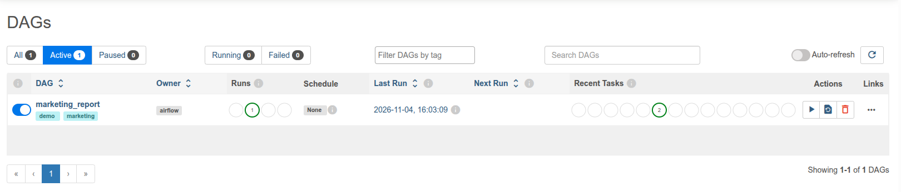
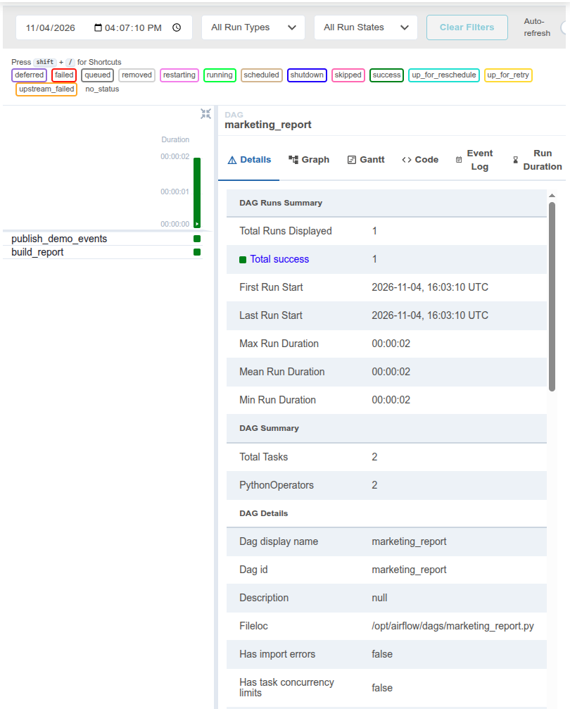
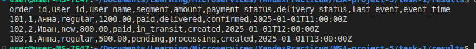

# Пакетная обработка данных маркетинга

## Выбор решения

Apache Airflow управляет последовательностью задач: запускает их по расписанию, отслеживает состояние, повторяет задачи при ошибках и поддерживает оповещения. Данные обрабатывают сами задачи, а не Airflow. Поэтому для роста нагрузки можно заменить обработку на Python задачей Spark, оставив расписание и зависимости в Airflow.

В Airflow есть готовые расширения для внешних API, BigQuery, Redshift, Kafka и Spark. Для реального подключения нужны соответствующие пакеты, учётные данные и настройки сети. В примере эти интеграции, кроме Kafka, не развёрнуты и не проверяются.

## Состав примера

- PostgreSQL хранит заказы и служебные данные Airflow. В рабочей системе эти базы лучше разделить.
- CSV содержит статусы доставки. Данные платежей и пользователей представлены локальными JSON-файлами: это имитация ответов внешних систем, а не работающие API.
- Kafka содержит события изменения заказов. Для демонстрации первая задача публикует события с идентификатором запуска, вторая читает ограниченный набор до зафиксированных конечных смещений и выбирает события этого запуска. Это учебная схема: в промышленной системе нужны отдельный источник событий, сохранение смещений, правила повторной обработки и хранения данных.
- Python объединяет данные по `order_id` и `user_id` и сохраняет отчёт в CSV. Для заказа с несколькими событиями выбирается последнее по `event_time`.

Пример предназначен для локальной проверки на нескольких записях, а не для оценки производительности. Объём около миллиона записей за запуск нужно проверить отдельно на данных и оборудовании, близких к рабочим; при необходимости использовать Spark и пакетную запись вместо загрузки всего набора в память.

## Запуск

Нужны Docker и Docker Compose, подключение к интернету для загрузки образов и пакета Kafka, а также свободные порты 8080, 5432 и 9092. Из каталога `task-1/results` выполните:

```bash
mkdir -p output
export AIRFLOW_UID=$(id -u)
docker compose up -d
docker compose logs -f airflow
```

Откройте <http://localhost:8080>. Имя пользователя — `admin`, пароль можно получить командой:

```bash
docker compose exec airflow cat /opt/airflow/standalone_admin_password.txt
```

Включите DAG `marketing_report` и запустите его вручную. Дождитесь успешного выполнения всех задач. Отчёт появится на компьютере в файле `./output/marketing_report.csv`. Его также можно посмотреть командой:

```bash
docker compose exec airflow cat /opt/airflow/output/marketing_report.csv
```

Ожидается три строки заказов; в отчёте указаны пользователь, сумма заказа, платёж, доставка и последнее событие. Повторный запуск перезаписывает отчёт. Отчёт сохраняется в локальной папке `output`, а служебная база — в томе Docker. Папку `output` нужно создать до запуска Compose, а `AIRFLOW_UID` задать в каждом терминале, из которого запускается Compose. Если папка или существующий том Airflow принадлежат другому пользователю, потребуется отдельно настроить права доступа.

Остановка без удаления данных:

```bash
docker compose down
```

Если порт занят, измените отображение порта в `docker-compose.yaml`. Изменения SQL-файла начальных данных применяются только при создании пустого тома PostgreSQL.

## Наблюдение и ограничения

В интерфейсе Airflow доступны граф зависимостей, состояние запусков и журналы задач. Для задач заданы повторная попытка и отправка письма при окончательной ошибке. Письма начнут отправляться только после настройки SMTP и замены адреса в DAG; без SMTP доставка уведомлений не проверяется.

### Скриншоты

Интерфейс Airflow:



Информация о DAG `marketing_report`:



Результат обработки:



Локальное развёртывание демонстрационное: пароль PostgreSQL указан открыто, Airflow работает в режиме `standalone`, а Kafka — с одним брокером. В облаке следует использовать управляемые или отказоустойчивые компоненты, отдельные базы, хранилище секретов, постоянное хранилище результатов и настроить SMTP, права доступа и мониторинг. Для ежедневной пакетной обработки событий потребуются сохранение границ чтения Kafka и защита от потери и повторного учёта событий.
