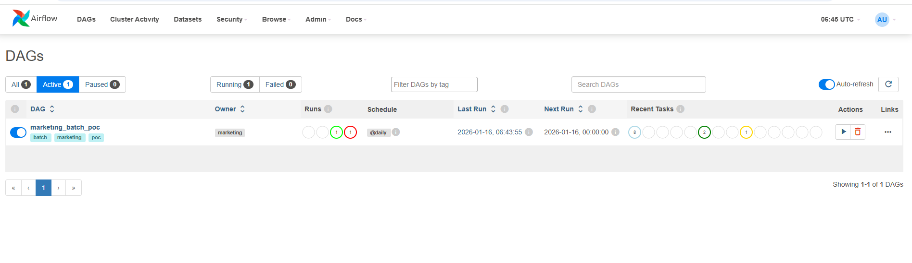
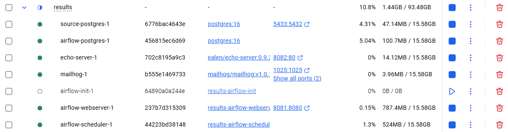
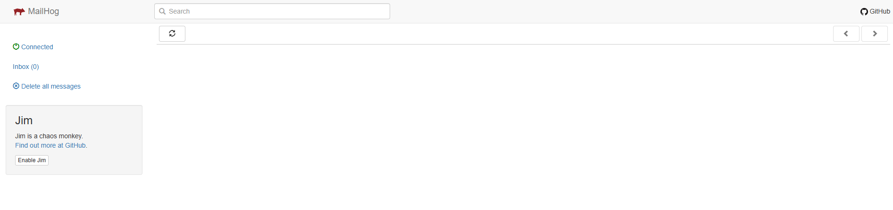
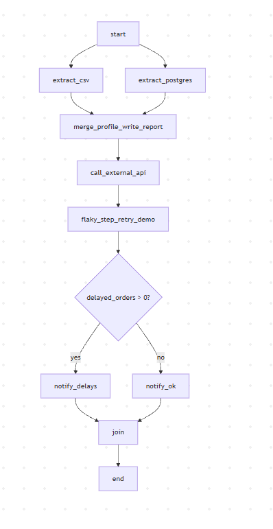

# Task1 — Batch Pipeline Orchestrator (POC на Apache Airflow)

## Что демонстрируем
- Источники: CSV (delivery statuses) + PostgreSQL (orders/users/payments)
- Аналитика + формирование отчёта в файл `out/report_<ds>.csv`
- Ветвление: если есть DELAYED — отправляем “delays” письмо, иначе “ok”
- Retry: шаг `flaky_step_retry_demo` падает 1 раз, затем проходит на retry
- Email: через MailHog (локально)
- HTTP-интеграция: запрос в локальный mock API (echo-server)

## Требования
- Docker + Docker Compose v2

## Запуск
Из папки `tasks/Task1/results`:

```bash

docker compose up -d --build
```
## Результаты



## Диаграмма
