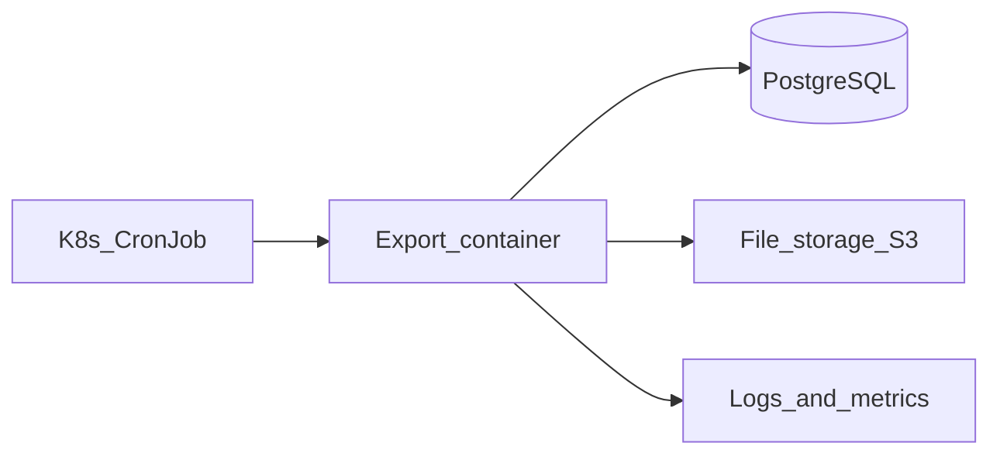

# C4 — уровень контекста (To Be)

## Текстовое описание

- **Пользователь / планировщик:** по расписанию (06:00) запускается **пакетная выгрузка** в Kubernetes.
- **Система выгрузки:** Job/CronJob выполняет запрос к **PostgreSQL** (связка `products`, `categories`, `clients`, `client_prices`), формирует **CSV** и сохраняет файл в **объектное хранилище** (S3-совместимое / корпоративное) или сетевую папку для B2B.
- **Наблюдаемость:** логи pod → **ELK**, метрики → **Prometheus/Grafana** 

## Диаграмма (Mermaid)

