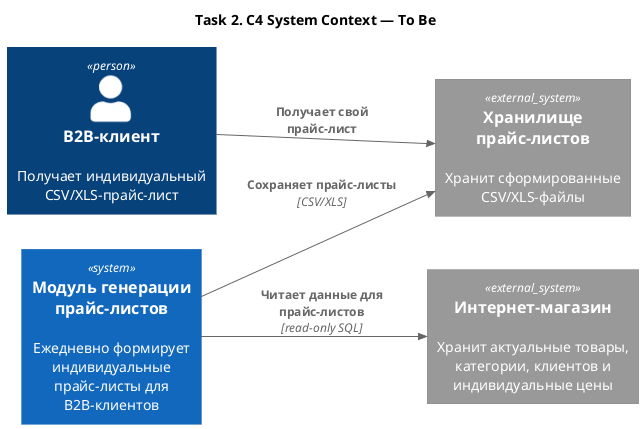

# Task 2. Дизайн модуля пакетной обработки

## Task 2.1. Выбор технологии

| Критерий | Spring Batch | Apache Airflow | Kubernetes Job | Apache Spark |
| --- | --- | --- | --- | --- |
| Тип | Java batch-фреймворк | Оркестратор data pipelines | Kubernetes-ресурс для разового выполнения | Распределённый движок обработки |
| Наличие CRON-расписания | Нет, нужен внешний scheduler | Есть расписание DAG | У Job нет; CronJob создаёт Job по расписанию | Нет, нужен внешний scheduler |
| Сложность реализации логики | Средняя: Job, Step, Reader и Writer избыточны для простого экспорта | Средняя: нужен DAG и инфраструктура Airflow | Низкая: одно приложение с SQL-запросом и экспортом CSV/XLS | Высокая: требуется распределённое Spark-приложение |
| Потребление ресурсов | Низкое или среднее: JVM работает во время job | Среднее или высокое: постоянные сервисы и metadata database | Низкое: Pod существует только во время выполнения | Высокое: driver, executors и Spark-инфраструктура |
| Масштабируемость и сложность | Есть partitioning, но потребуется дополнительная настройка | Хорошо масштабирует оркестрацию, а не саму обработку | Ресурсы Pod и параллельные Jobs настраиваются в Kubernetes | Высокая встроенная масштабируемость |
| Облако и микросервисы | Хорошо запускается в контейнере, но нужен scheduler | Требует отдельной платформы или managed Airflow | Хорошо использует существующий Kubernetes-кластер | Требует Spark Operator или managed-сервиса |
| Логирование и мониторинг | Spring Actuator, Micrometer и логи; нужна настройка | Web UI, история запусков, логи и метрики | Стандартные логи, статусы Jobs и мониторинг Kubernetes | Spark UI, логи и метрики |

### Решение

Выбран **Kubernetes CronJob, создающий Kubernetes Job**.

Причины:

1. Обработка запускается один раз в день в 06:00.
2. Данные небольшие, а логика ограничена SQL-запросом и формированием файлов.
3. Приложение потребляет ресурсы только во время выполнения.
4. Решение использует существующую Kubernetes-инфраструктуру магазина.
5. Для логов и мониторинга применяются стандартные средства платформы.

Spring Batch добавит ненужную для этой задачи структуру batch jobs. Airflow потребует отдельную постоянно работающую платформу. Spark предназначен для существенно больших объёмов и распределённых вычислений.

## Task 2.2. Проектирование решения

### C4 System Context — To Be

### Как работает решение

1. Kubernetes CronJob в 06:00 создаёт Job с контейнером генератора.
2. Приложение подключается к PostgreSQL с правами только на чтение.
3. Один SQL-запрос связывает `products`, `categories`, `clients` и `client_prices`.
4. Результат группируется по клиентам и записывается в индивидуальные CSV/XLS-файлы без дополнительной обработки.
5. Файлы сохраняются в защищённом файловом или объектном хранилище, откуда их получает B2B-клиент.
6. После завершения Pod освобождает ресурсы. Статус Job и логи остаются доступны в Kubernetes.

Способ доставки файлов клиентам зависит от существующей платформы и не входит в границы этого задания.

### План реализации

1. Реализовать небольшое приложение экспорта и SQL-запрос к PostgreSQL.
2. Добавить формирование отдельного CSV/XLS для каждого клиента.
3. Собрать приложение в Docker-образ.
4. Передать настройки БД и хранилища через ConfigMap и Secret.
5. Настроить CronJob: `0 6 * * *`, бизнес-часовой пояс, `concurrencyPolicy: Forbid`, ресурсы и `backoffLimit`.
6. Настроить защищённую запись файлов, срок хранения и удаление устаревших прайс-листов.
7. Направить логи в стандартный вывод и подключить существующие мониторинг и оповещения Kubernetes.
8. Проверить успешный запуск, повтор после ошибки и отсутствие одновременных запусков.
