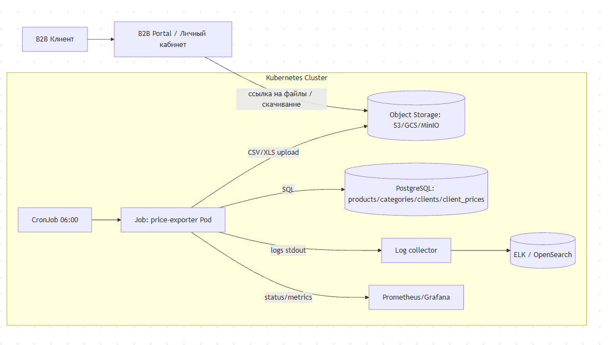

| Критерий                                             | Spring Batch                                                         | Apache Airflow                                    | K8s Job (CronJob)                             | Spark                                                        |
| ---------------------------------------------------- | -------------------------------------------------------------------- | ------------------------------------------------- | --------------------------------------------- | ------------------------------------------------------------ |
| Наличие конфигурации CRON-расписания                 | ⚠️ (через внеш. scheduler или Spring Scheduling; лучше не смешивать) | ✅ (встроенное расписание DAG)                     | ✅ (CRON в CronJob)                            | ⚠️ (нужен внешний scheduler: Airflow/Oozie/cron/k8s)         |
| Сложность реализации логики обработки                | ⚠️ (порог входа/инфра, но ETL удобно)                                | ⚠️ (DAG + infra; для простого экспорта избыточно) | ✅ (простой контейнер: SQL → CSV/XLS → upload) | ❌ (избыточно для 10k строк и join)                           |
| Ресурсоёмкость                                       | ⚠️ (Java app + DB метаданных batch)                                  | ❌ (webserver/scheduler/db/worker)                 | ✅ (один pod по расписанию)                    | ❌ (кластер/драйвер/экзекьюторы)                              |
| Масштабируемость под нагрузкой и сложность           | ⚠️ (масштабируется, но усложняется)                                  | ✅ (очереди/пулы/воркеры)                          | ✅ (параллелизм через Jobs, простая эволюция)  | ✅ (но цена/сложность высокая)                                |
| Развёртывание в облаке и интеграция с микросервисами | ⚠️ (нужно приложение, конфиги, секреты, rollout)                     | ⚠️ (Helm/Managed Airflow, но отдельная платформа) | ✅ (нативно k8s, один манифест + образ)        | ⚠️/❌ (зависит от платформы; обычно отдельная data-платформа) |
| Интеграция с логированием и мониторингом             | ✅ (Actuator/JMX, структурные логи)                                   | ✅ (логи/метрики, алерты)                          | ✅ (stdout + job status + push metrics)        | ⚠️ (зависит от платформы)                                    |

**Вывод:** для текущих объёмов и простой логики лучше всего **K8s CronJob**: минимальная инфраструктура, понятный деплой, легко наблюдать/алертить, и без “платформенного оверхеда” Airflow/Spark. Spring Batch оправдан, если экспорт станет настоящим ETL с тяжёлыми шагами и сложной обработкой.

---

### 3.2. C4 Context 



#### Как работает (To-Be, шаги процесса)

1. В **06:00** срабатывает Kubernetes CronJob → создаётся Job → запускается контейнер `price-exporter`.
2. `price-exporter`:

    * получает креды к PostgreSQL  и конфиг (ConfigMap: формат CSV/XLS, префиксы путей, batch size),
    * читает список clients (100–500),
    * для каждого клиента делает запрос join (products + categories + client_prices),
    * формирует CSV и/или XLSX (временный файл → атомарная публикация),
    * загружает результат в Object Storage.
3. B2B Portal отображает ссылки на файлы (либо читает их из object storage по подписанным URL).
4. Наблюдаемость:

    * логи в stdout → ELK,
    * статус Job/CronJob + алерты (если Job failed),
    * опционально метрики длительности/количества файлов через Pushgateway/Prometheus.

---

### 3.3. Верхнеуровневый план конфигурации и имплементации

#### A) Данные и запросы

1. Сформировать SQL (пример на клиента):

```sql
SELECT
  p.sku,
  p.name,
  c.name AS category,
  COALESCE(cp.price, p.base_price) AS price
FROM products p
JOIN categories c ON c.category_id = p.category_id
LEFT JOIN client_prices cp
  ON cp.product_id = p.product_id
 AND cp.client_id = :client_id
ORDER BY c.name, p.name;
```

2. Если нужно ускорить:
    * индексы `client_prices(client_id, product_id)`, `products(category_id)`.

#### B) Генератор прайс-листов (контейнер)

3. Реализовать `price-exporter`:

    * параметры: `DB_DSN`, `OUTPUT_FORMATS=csv,xlsx`, `S3_BUCKET`, `PREFIX`, `RUN_DATE`.
    * поведение: “idempotent by date” — перезаписывает/версионирует файлы за текущую дату.
    * формирование XLSX: `xlsxwriter`.
4. Выгрузка в объектное хранилище:

    * AWS S3/GCS/Azure Blob; для локальной отладки можно MinIO.
    * путь хранения: `price-lists/YYYY-MM-DD/client_id/price.csv` и `price.xlsx`.

#### C) Kubernetes конфигурация

5. Kubernetes Secret:

    * `DB_DSN` (или host/user/pass/db),
    * креды к object storage (access key/secret).
6. ConfigMap:

    * расписание, форматы, параметры выгрузки (разделители CSV, локаль, кодировка).
7. CronJob:

    * `schedule: "0 6 * * *"`
    * `concurrencyPolicy: Forbid` (чтобы не было параллельных запусков)
    * `startingDeadlineSeconds` (например 600)
    * `backoffLimit` (например 2–3)
    * `resources requests/limits` (скромные)
    * `ttlSecondsAfterFinished` для уборки завершённых Job
8. Наблюдаемость:

    * stdout/stderr → централизованный сбор логов
    * алерт: “CronJob failed N раз подряд” или “Job не завершился за X минут”
    * метрики: push в Pushgateway `price_export_duration_seconds`, `price_export_files_total`, `price_export_failed_total`.

#### D) Интеграция с B2B порталом

9. Portal получает список файлов:
* строит путь по `date/client_id`
10. Выдача доступа:
* через pre-signed URLs

#### E) Обработка ошибок и качество

11. Ошибки:
* DB недоступна → Job failed + retry/backoff (k8s) + алерт.
* partial generation → писать во временный key и “атомарно” переименовывать/копировать после успеха.

12. Контроль консистентности:

* checksum файла, размер, количество строк,
* логировать counts: clients processed, files generated.
