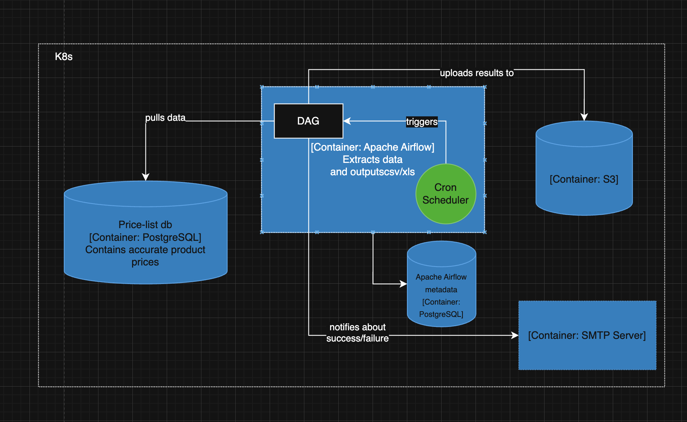

## Problem statement

An online shop must provide a `csv/xls` files for `b2b` clients.
A `PostgreSQL` database serves as a data source.
No data transformations required.
A database schema is comprised of these tables:
* `product`;
* `categories`;
* `clients`;
* `client_prices`.

A dataset size is within `[5,10]k` rows.
The online shop has a cloud infrastructure.

## Solutions comparison

| Feature | `Spring Batch` | `Apache Airflow` | `K8s Job` | `Spark` |
| -- | -- | -- | -- | -- |
| Supports cron schedule | Supports through `@Scheduled` annotation, external schedulers (e.g. `Quartz`) or through `Spring Cloud Data Flow` | Supports through an argument to `dag` | no, but `CronJob` does | no, needs an external orchestrator |
| Data handling logic implementation complexity | `low` | `low-moderate` | `low` | `high` |
| Resources consumption | `low` | `low` | `low` | `high` |
| Highload readiness | `high` | `high` | `moderate-high` | `high` |
| Cloud deployment complexity and integration with existing infrastructure | `low-moderate` | `low-moderate` | `low-moderate` | `moderate-high` |
| Integration with monitoring/logging systems | yes | yes | yes | yes |

## Proposed solution

### Primary

`Apache Airflow` seems to be a prominent candidate for these reasons:
* flexible and cheap data pipeline extension for future (`dag` supports conditions, events, retries, fallback out of the box);
* ready for highload out of the box since it's a distributed system;
* has a comfortable `ui`;
* has out of the box integrations with popular third-party systems (`Redshift`, `BigQuery`, `Kafka`), and a custom integration can be implemented;
* can integrate user-generated content from `Jupyter` notebooks;
* suitable for `AI models` training based on the produced data;
* moderate memory footprint;
* it's easier to find a `Python` developer than `Java` developer.

## Alternative

[COPY](https://www.postgresql.org/docs/current/sql-copy.html) command can be used for generating `csv` based on the problem statement.

## Context diagram

A diagram source code is in `msa-sprint5-task2.drawio`.

## High-level implementation plan

1. prepare resources quota;
2. set up infrastructure:
    * network access;
    * smtp server;
    * apache airflow server;
    * apache airflow metadata db.
3. implement a dag;
4. cover implementation with unit tests (`pytest`);
5. set up observability:
    * cloud logging;
    * alerts;
    * notifications.
6. gather metrics (Utilization, saturation, errors);
7. prepare dashboards for metrics visualization;
8. set up access rights:
    * reader (can only view the configuration and the last result);
    * editor (can read and change params).
9. e2e tests (`Playwright` + `TestContainers`):
    * positive case:
        - no retries;
        - with retries.
    * negative case:
        - no data;
        - dag failure;
        - dag is hanging.
10. load testing:
    - 1k rows;
    - 10k rows;
    - 50k rows;
    - 250k rows;
    - 1m rows;
    - 5m rows.