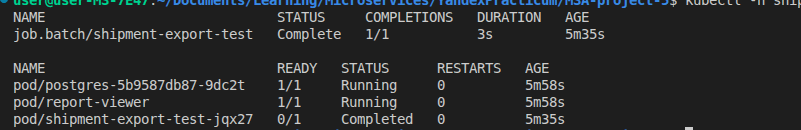
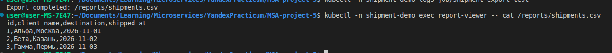

# Ежедневная выгрузка перевозок

Демонстрация Kubernetes CronJob для MiniKube: PostgreSQL → Job → CSV на постоянном томе. Приложение выгружает одну таблицу `shipments` целиком, как допускает задание. Тестовые данные не представляют реальный дневной объём. Для промышленной выгрузки нужно отдельно определить границы дня, согласованность данных и способ передачи файлов в аналитическое хранилище.

## Состав

- `export.py`, `Dockerfile`, `requirements.txt` — приложение и образ для экспорта.
- `k8s/` — отдельное пространство имён, тестовая PostgreSQL, том, CronJob и вспомогательный Pod для чтения результата.
- Тестовая база хранится в `emptyDir`: при пересоздании Pod она инициализируется заново. CSV хранится отдельно в PVC и переживает завершение Job. Учётные данные в манифесте предназначены только для локальной демонстрации.

## Запуск в MiniKube

Нужны Docker, MiniKube и kubectl. Команды выполняются из `task-3/results`:

```bash
minikube start
minikube image build -t shipment-export:1.0 .
kubectl apply -f k8s/namespace.yaml
kubectl apply -f k8s/resources.yaml
kubectl -n shipment-demo rollout status deployment/postgres --timeout=180s
kubectl -n shipment-demo wait --for=condition=Ready pod/report-viewer --timeout=180s
kubectl -n shipment-demo get cronjob
```

CronJob запланирован на `0 20 * * *` по UTC. Часовой пояс бизнес-процесса в задании не указан: перед внедрением его нужно согласовать и изменить `spec.timeZone`. Поле `timeZone` поддерживается в Kubernetes 1.27 и новее. Запуск по расписанию может задержаться или быть пропущен при сбоях: для строгого срока необходимы контроль готовности результата и процедура восстановления.

## Проверка без ожидания 20:00

Создайте Job из CronJob; если Job с таким именем уже существует, используйте другое имя:

```bash
kubectl -n shipment-demo create job --from=cronjob/shipment-export shipment-export-test
kubectl -n shipment-demo wait --for=condition=complete job/shipment-export-test --timeout=120s
kubectl -n shipment-demo get jobs,pods
kubectl -n shipment-demo logs job/shipment-export-test
kubectl -n shipment-demo exec report-viewer -- cat /reports/shipments.csv
```

Ожидается CSV с заголовком и тремя тестовыми перевозками. Чтобы скопировать результат на компьютер:

```bash
kubectl -n shipment-demo cp report-viewer:/reports/shipments.csv ./shipments.csv
```

Каждый успешный запуск атомарно заменяет `shipments.csv`; история файлов не сохраняется. `concurrencyPolicy: Forbid` предотвращает параллельные **запуски CronJob**, но вручную созданный Job он не ограничивает: не запускайте ручную проверку одновременно с плановой задачей. При ошибке Job выполняет повторные попытки; состояние и журналы доступны через kubectl. Для реальной эксплуатации нужны сбор журналов, оповещения и разграничение доступа к файлам.

## Результат проверки

Состояние Job и Pod:



Результат выгрузки:



При необходимости очистить только ресурсы демонстрации:

```bash
kubectl delete namespace shipment-demo
```

Удаление пространства имён также удалит PVC и результат выгрузки. Не выполняйте команду, если CSV нужно сохранить.
