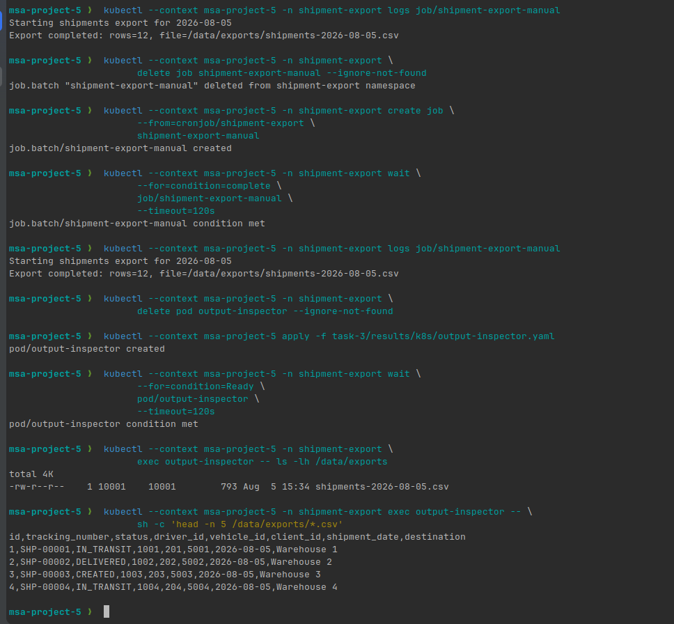

# Task 3. Distributed Scheduling с Kubernetes CronJob

Java-приложение подключается к PostgreSQL через JDBC, выгружает за текущий день строки таблицы `shipments` в CSV и завершает работу. Kubernetes CronJob запускает приложение ежедневно в 20:00 по часовому поясу `Europe/Moscow`.

CSV сначала записывается во временный файл, а после успешного завершения атомарно перемещается в итоговый файл `shipments-YYYY-MM-DD.csv`. Результат хранится в PersistentVolumeClaim.

## Состав решения

- `app` — код Java-приложения и тесты;
- `Dockerfile` — сборка исполняемого контейнера;
- `k8s/demo-environment.yaml` — PostgreSQL, тестовые данные и PVC;
- `k8s/cronjob.yaml` — CronJob с расписанием `0 20 * * *`;
- `k8s/output-inspector.yaml` — Pod для проверки созданного CSV.

Команды локального запуска находятся в [отдельной инструкции](INSTRUCTIONS.md).

## Демонстрация

