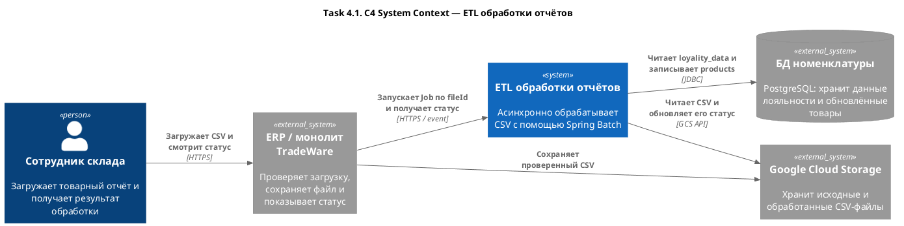
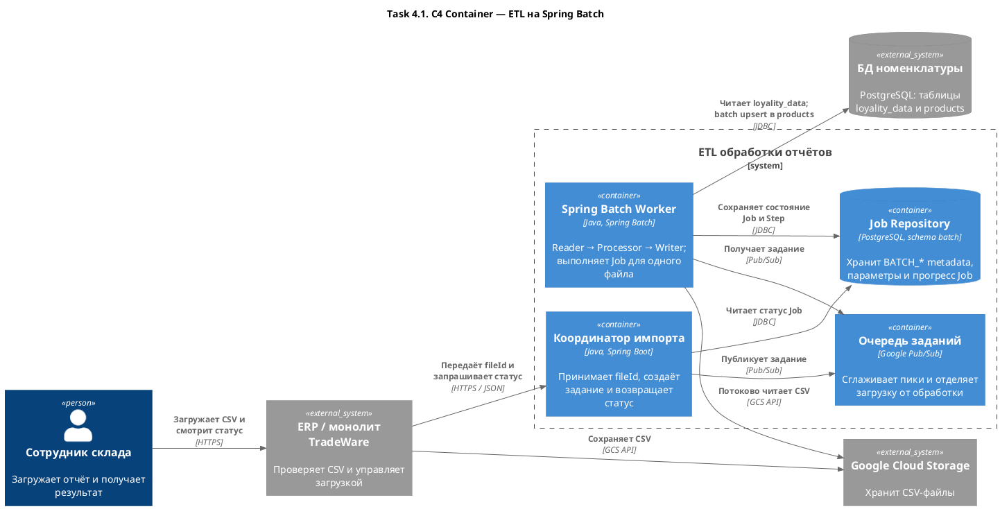

# ADR: Использование Spring Batch для ETL-обработки товарных отчётов

**Автор:** команда TradeWare  
**Дата:** 2026-08-05

## Функциональные требования

| № | Действующие лица или системы | Use Case | Описание |
|---:|---|---|---|
| 1 | Сотрудник склада, ERP, GCS | Передать отчёт на обработку | 1. Сотрудник загружает CSV. 2. ERP проверяет формат. 3. ERP сохраняет файл в GCS. 4. ETL-система получает `fileId`. |
| 2 | Spring Batch, GCS, PostgreSQL | Обработать отчёт | 1. Worker читает товары из CSV. 2. Обогащает их из `loyality_data`. 3. Пакетно записывает результат в `products`. 4. Сохраняет прогресс Job. |
| 3 | ERP, сотрудник склада | Получить результат | 1. ETL-система завершает Job. 2. ERP получает итоговый статус. 3. Сотрудник видит успешный результат или ошибку. |
| 4 | Spring Batch, служба поддержки | Повторить обработку | 1. Временная ошибка вызывает retry. 2. После остановки Job продолжается с последнего chunk. 3. Для неисправимой ошибки сохраняются статус и причина. |

## Нефункциональные требования

| № | Требование |
|---:|---|
| 1 | Обрабатывать отчёт из 2 000 строк в среднем не дольше 30 секунд. |
| 2 | Поддерживать 100–150 одновременных загрузок без блокировки ERP. |
| 3 | Обрабатывать около 400 000 строк в сутки и рост нагрузки в 2–3 раза. |
| 4 | Масштабировать обработчики горизонтально, сохраняя ограничение нагрузки на PostgreSQL. |
| 5 | Поддерживать restart, retry и фиксацию прогресса после каждого chunk. |
| 6 | Не создавать дубликаты при повторном запуске одного файла. |
| 7 | Передавать логи, метрики Job и причины ошибок в централизованную систему наблюдаемости. |
| 8 | Запускаться локально в Docker Compose и переноситься в GCP без изменения ETL-логики. |

## Решение

Выделить обработку отчётов из монолита в отдельное контейнерное приложение на Spring Batch. ERP только проверяет загрузку, сохраняет CSV в GCS и асинхронно запускает Job. Пользовательский запрос не ожидает окончания ETL.

### Анализ проблем

- синхронная построчная обработка блокирует ERP и создаёт много транзакций;
- монолит не масштабирует обработку отдельно от пользовательских запросов;
- отсутствуют сохранение прогресса, управляемый retry и безопасный restart;
- пики до 100–150 загрузок могут исчерпать соединения и ресурсы PostgreSQL;
- разрозненные логи не позволяют быстро определить файл, Job и причину ошибки.

### Поток обработки

1. Координатор получает `fileId` и адрес объекта в GCS и ставит задание в очередь.
2. Свободный Spring Batch Worker запускает отдельный Job для файла.
3. `FlatFileItemReader` читает CSV последовательно, не загружая файл целиком в память.
4. `ItemProcessor` обогащает товар по `productSku`. Справочные данные читаются пакетно или кэшируются на время Job, чтобы избежать отдельного SQL-запроса для каждой строки.
5. `JdbcBatchItemWriter` выполняет идемпотентный upsert в `products` внутри транзакции chunk.
6. Job Repository сохраняет параметры, статус и прогресс. ERP получает итоговый статус и показывает его сотруднику.

Начальный размер chunk — **500 строк**. Для отчёта из 2 000 строк это четыре транзакции. Значение должно оставаться настраиваемым и проверяться нагрузочным тестом.

### Хранение данных

| Хранилище | Назначение |
|---|---|
| GCS | Исходные CSV; после обработки файл получает статус или переносится в префикс `processed`/`failed`. |
| PostgreSQL, прикладная схема | Таблицы `loyality_data` и `products`. |
| PostgreSQL, batch-схема | Таблицы Spring Batch `BATCH_*` с состоянием Job и Step. |

`fileId` или контрольная сумма передаётся как уникальный Job Parameter. Вместе с upsert это защищает от повторной записи одного отчёта.

### Масштабирование и запуск

- задания разных файлов независимы и могут выполняться несколькими Worker-контейнерами;
- очередь сглаживает пик и не позволяет загрузкам блокировать ERP;
- число Worker и соединений с БД ограничивается настройками пула и допустимой нагрузкой PostgreSQL;
- retry применяется только к временным ошибкам, например разрыву соединения;
- ошибки формата не повторяются автоматически и возвращаются сотруднику.

В локальном POC очередь и GCS заменяются запуском Job при старте контейнера и CSV из ресурсов. Spring Batch, модель Job и PostgreSQL остаются теми же, поэтому ETL-логика переносится в целевую среду без переписывания.

### C4 System Context

### C4 Container

## Альтернативы

| Альтернатива | Преимущества | Почему не выбрана основной |
|---|---|---|
| Apache Beam + Google Dataflow | Управляемое масштабирование и высокая производительность для больших потоков | Для файлов по 2 000 строк решение сложнее и дороже необходимого; потребуется переписать Spring Batch POC. |
| Apache Airflow / Cloud Composer | Удобная оркестрация зависимых пайплайнов, расписания и наблюдение | Airflow должен запускать вычислительные Job, но не заменяет транзакционную обработку строк и Job Repository. |
| Spring Cloud Data Flow | Управляет развёртыванием, расписанием и мониторингом Spring Batch Job | Добавляет отдельную платформу. Её можно подключить позже, если количества Job и способов запуска станет много. |
| Java-приложение без batch-фреймворка | Минимум зависимостей и полный контроль | Потребуется самостоятельно реализовать chunk-транзакции, restart, retry и хранение состояния выполнения. |

Spring Batch выбран из-за совместимости с Java-стеком TradeWare, готовой chunk-обработки, транзакций и Job Repository. Он покрывает POC без отдельной тяжёлой платформы и допускает последующее контейнерное масштабирование.

## Недостатки, ограничения, риски

| Риск или ограничение | Снижение риска |
|---|---|
| Spring Batch сам не является распределённым планировщиком или очередью | Использовать внешний триггер и очередь; в GCP — Pub/Sub и оркестрацию контейнеров. |
| 100–150 параллельных Job могут перегрузить PostgreSQL | Ограничивать число Worker, размер пула соединений и конкурентных Job; провести нагрузочное тестирование. |
| Поиск данных лояльности для каждой строки создаст проблему N+1 | Загружать справочник пакетно или использовать Job-scoped cache. |
| Слишком большой chunk увеличит память и объём повторной работы после rollback | Хранить размер chunk в конфигурации и подобрать его тестами. |
| Повторная доставка задания может запустить тот же файл дважды | Использовать уникальный `fileId` как Job Parameter и идемпотентный upsert. |
| Локальный POC не проверяет интеграцию с GCS и очередью | Изолировать доступ к файлам и запуск Job за интерфейсами и добавить интеграционные тесты перед переносом в GCP. |
