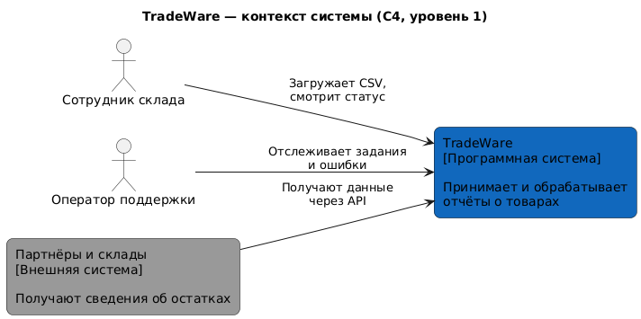
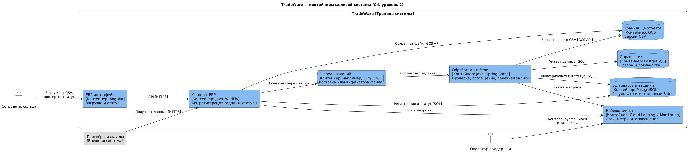

# C4: целевая архитектура

Диаграммы описывают предложение; в локальном POC реализованы только Spring Batch, локальный CSV и PostgreSQL.

## Контекст системы

Исходный файл: [context.puml](context.puml).

## Контейнеры

Исходный файл: [containers.puml](containers.puml).

Очередь, outbox, доступ к GCS, мониторинг и отдельная БД справочника показаны как целевые компоненты. В POC обе предметные таблицы и метаданные Batch находятся в одном PostgreSQL.
