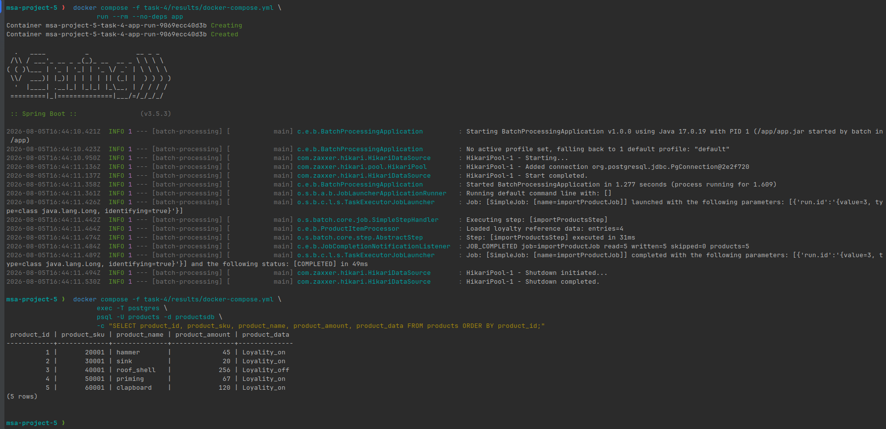

# Task 4. Spring Batch ETL

## Архитектура

- [ADR архитектурного решения](ADR.md);
- [C4 System Context](diagrams/task-4-context.png);
- [C4 Container](diagrams/task-4-container.png).

## Реализация

- `src` — Spring Batch Job и тестовые CSV;
- `schema-all.sql` — таблицы `loyality_data` и `products`;
- `Dockerfile` и `docker-compose.yml` — локальный запуск приложения и PostgreSQL;
- [INSTRUCTIONS.md](INSTRUCTIONS.md) — команды запуска и проверки.

## Демонстрация

