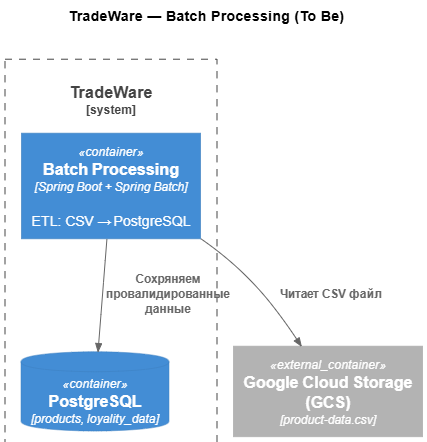

# **Название задачи:** Реализация ETL с использованием Spring Batch  
### **Автор:** Степанов Андрей  
### **Дата:** 01.03.2026  

---

### **Функциональные требования**

| № | Действующие лица или системы | Use Case | Описание |
|:-:|-----------------------------|----------|----------|
| 1 | Файловая система (CSV) | Загрузка данных о товарах | Чтение файла `product-data.csv` из classpath с полями: `productId`, `productSku`, `productName`, `productAmount`, `productData` |
| 2 | PostgreSQL | Запись обновлённых данных | Вставка записей в таблицу `products` с применением бизнес-логики (обогащение данными из `loyality_data`) |
| 3 | JobCompletionNotificationListener | Вывод результата выполнения | Логирование статуса завершения джоба и выборка содержимого таблицы `products` для валидации |

---

### **Нефункциональные требования**

| № | Требование |
|:-:|------------|
| 1 | Обработка данных чанками (chunk-oriented processing) с настраиваемым размером пакета |
| 2 | Автоматический перезапуск при сбоях (restartability) с сохранением состояния выполнения |
| 3 | Структурированное логирование статуса джоба, ошибок и результатов в консоль |
| 4 | Запуск в Docker-контейнере через Docker Compose с минимальной конфигурацией |
| 5 | Использование Java 21 + Spring Boot 3.5 + Spring Batch 5.2 |
| 6 | Минимальная внешняя инфраструктура (только PostgreSQL, без дополнительных оркестраторов) |
| 7 | Идёмпотентность: повторный запуск джоба не должен создавать дубликаты данных |

---

### **Решение**

**Выбранное решение:** Spring Batch в составе Spring Boot приложения.

**C4-диаграмма (Container level — To Be):**

  

**Основные компоненты и интеграции:**
- `Spring Boot App` → `Spring Batch Job` → `FlatFileItemReader` → `ProductItemProcessor` → `JdbcBatchItemWriter`
- Источник данных: `product-data.csv` (в classpath, кодировка UTF-8)
- Справочник лояльности: таблица `loyality_data` (PostgreSQL) — используется для обогащения данных в `ItemProcessor`
- Целевая таблица: `products` (PostgreSQL) — финальное хранилище обработанных данных

**Логика выбора технологии:**
- **Spring Batch** — де-факто стандарт для пакетной обработки в Java-экосистеме, предоставляет из коробки:
  - Chunk-oriented processing с транзакционным управлением
  - Механизмы retry, skip, restartability для отказоустойчивости
  - Встроенную интеграцию со Spring Boot (автоконфигурация JobLauncher, HikariCP, Actuator)
- **Простота эксплуатации** — не требует отдельной инфраструктуры (в отличие от Airflow), развёртывается как обычное Spring Boot приложение
- **Мониторинг** — статус джоба, метрики и логи доступны через стандартные средства Spring Boot Actuator и консоль
- **Соответствие стеку** — решение полностью укладывается в существующий стек компании (Java + Spring + PostgreSQL)

**Результат выполнения:**
```
Job: [importProductJob] completed with status [COMPLETED]
```
[Скриншот логов](results-log.png)  

### **Альтернативы**

| Технология | Причины отклонения |
|------------|-------------------|
| **Apache Airflow** | Требует развёртывания отдельного оркестратора (webserver, scheduler, metadata DB), избыточен для одного линейного джоба без сложных зависимостей |
| **Kubernetes Job + скрипт (Python/C#)** | Отсутствие встроенных механизмов chunking, retry, restartability; требуется ручная реализация логирования, метрик и обработки ошибок; сложнее поддерживать и мониторить |
| **Apache Spark** | Избыточная сложность и ресурсоёмкость для объёма данных до 1 млн строк; требует отдельного кластера или Spark on K8s, что увеличивает операционные затраты |
| **Spring Cloud Task** | Подходит для коротких задач, но не предоставляет встроенной поддержки chunk-oriented processing и продвинутых паттернов обработки данных |

---

### **Недостатки, ограничения, риски**

| Риск / Ограничение | Описание | Митигация |
|-------------------|----------|-----------|
| **Ошибка в SQL-запросе в `ItemProcessor`** | При отсутствии записи в `loyality_data` для `productSku` может возникнуть `NullPointerException` или ошибка маппинга | Обёртка запроса в try-catch с fallback на значение `"NO_LOYALITY"`; добавление логирования предупреждений для отсутствующих записей |
| **Ограничение по размеру CSV-файла** | При очень больших файлах (>10 млн строк) может возрастить время обработки и потребление памяти | Использование `FlatFileItemReader` с настройкой `setLinesToSkip`, `setEncoding` и оптимизация размера чанка; при необходимости — переход на потоковую обработку |
| **Зависимость от JVM** | Потребление памяти и время старта выше, чем у нативных скриптов (Python/Bash) | Приемлемо для текущих объёмов данных и стека компании; при росте нагрузки — рассмотреть GraalVM Native Image для уменьшения footprint |
| **Идёмпотентность при повторном запуске** | Повторный запуск джоба может привести к дублированию записей в таблице `products` | Использование `INSERT ... ON CONFLICT (product_id) DO UPDATE` или предварительная очистка таблицы перед запуском; документирование поведения для операторов |
| **Жёсткая привязка к структуре CSV** | Изменение формата входного файла потребует изменения кода `FieldSetMapper` | Валидация структуры CSV на этапе чтения; добавление unit-тестов для `FlatFileItemReader`; документирование ожидаемого формата |