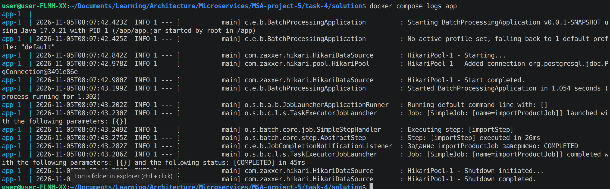
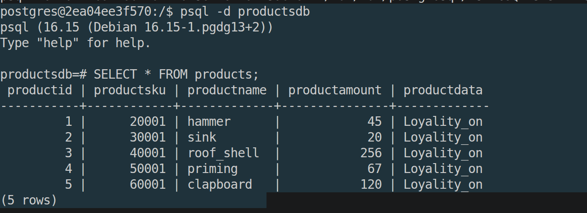
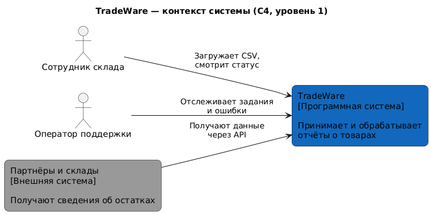
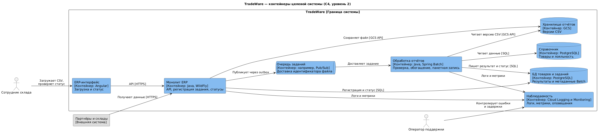

# Результаты задания 4

- [ADR](ADR.md) — анализ и обоснование архитектурного решения.
- [C4-диаграммы](C4.md) — контекст и контейнеры целевой системы.

Исходный код приложения, Docker Compose и инструкции по запуску находятся в [`../solution`](../solution/README.md).

## Результат работы приложения

В журнале видно, что задание `importProductJob` завершилось со статусом `COMPLETED`:



Таблица `products` после обработки содержит пять товаров:



## Контекст системы



[Исходный файл PlantUML](context.puml)

## Контейнеры целевой системы



[Исходный файл PlantUML](containers.puml)

Для повторной генерации изображений при установленном PlantUML выполните в этом каталоге:

```bash
plantuml -charset UTF-8 context.puml containers.puml
```
