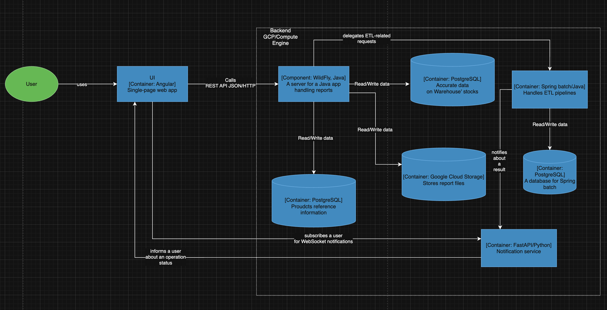

### ⚠️ Important

Since the initial repo **already contains** [implementation](https://github.com/Yandex-Practicum/msa-project-5/tree/main/task-4/complete) for an `ETL` pipeline steps, I've decided to focus on the infrastructure layer to ensure the solution is feasible.

### **Task name: MSA-sprint-5-task-4, implementing ETL using Spring Batch** 
### **Author: Viacheslav Moskalenko**
### **Date: 11.12.2025**
### **Functional requirements**
High-level use cases.

|**№**|**Actors**|**Use Case**|**Description**|
| :-: | :- | :- | :- |
|||||
| 1 | User, App | A user uploads an Excel file | In case of successful validation, the app processes the file and stores the updated product information in a database |
| 2 | User, App | A user is notified about a result | A user receives an operation's status report (success/failure) | 
### **Non-functional requirements**

|**№**|**Requirement**|
| :-: | :- |
|||
| 1 | A system must endure `[100-150]` parallel uploads during peak hours |
| 2 | An average processing time is within `30` seconds for a report comprised of `2k` rows |
| 3 | Centralized monitoring and metrics scrapping |
| 4 | A solution must adapt to a microservice architecture |
### **Solution**

New components:
1. a notifications service, which communicates with a user in an async manner (websockets);
2. `Spring Batch` for handling any `ETL`-related work either directly from the app (delegation), or directly (e.g. a scheduled job);
3. a `PostgreSQL` database for `Spring Batch`.

Plan:
1. `[mvp stage]`. No notification service is in place. A ui polls the app for notifications using exponential backoff;
2. `[target state]`. The notifications service is in use. A ui receives almost real-time notifications about an operation status. The approach could be extended to report an intermediate progress.

Reasons:
1. the team is already skilled in `Java` since they have a monolith app;
2. `Spring Batch` integration into existing `Java` ecosystem:
  - is relatively easy;
  - allows for code reuse;
  - can be easily modified once the app transitions to a microservices architecture.
3. the business sees peformance improvement once all the ETL workloads are delegated to `Spring Batch`, therefore, reducing {financial,pr} risks;
4. `Spring Batch` is a highload-oriented solution;
5. easier to track resources distribution (app vs ETL pipelines) and account a budget for that;
6. metrics scrapping and their visualization provide in-depth insights into `SLA` compliance.

### **Demo**

https://disk.yandex.ru/i/hbN8dcjKgJQFqw

### **Alternatives**
1. `Apache Airflow` might be an alternative:
  * lower memory footprint;
  * retries, fallbacks, schedule is out of the box;
  * built-in ui;
  * ready for highload.

2. `Spring Cloud Data Flow` (`SCDF`) is an alternative solution, which:
  * aligns a microservices architecture;
  * extends `Spark Batch`;
  * has all the features for scaling and monitoring.

**Drawbacks, Limitations, Risks**

1. `Java` has a memory footprint, which might impact a solution's cost in the long-term;
2. a team of qualified engineers is required since `Spring` is a rather sophisticated framework;
3. gradual shift to `SCDF` might be required in the future.