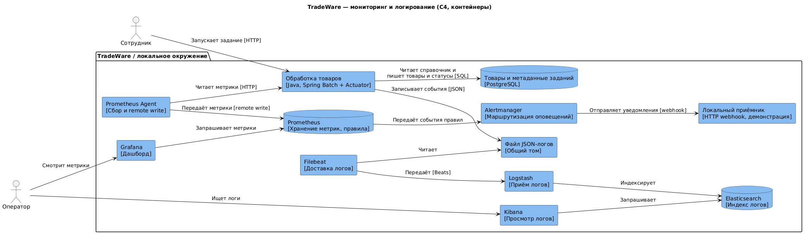
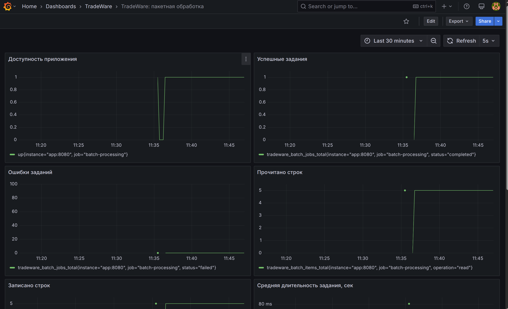
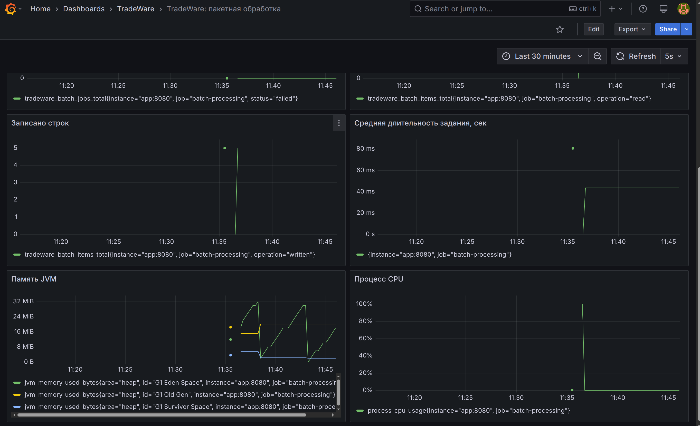
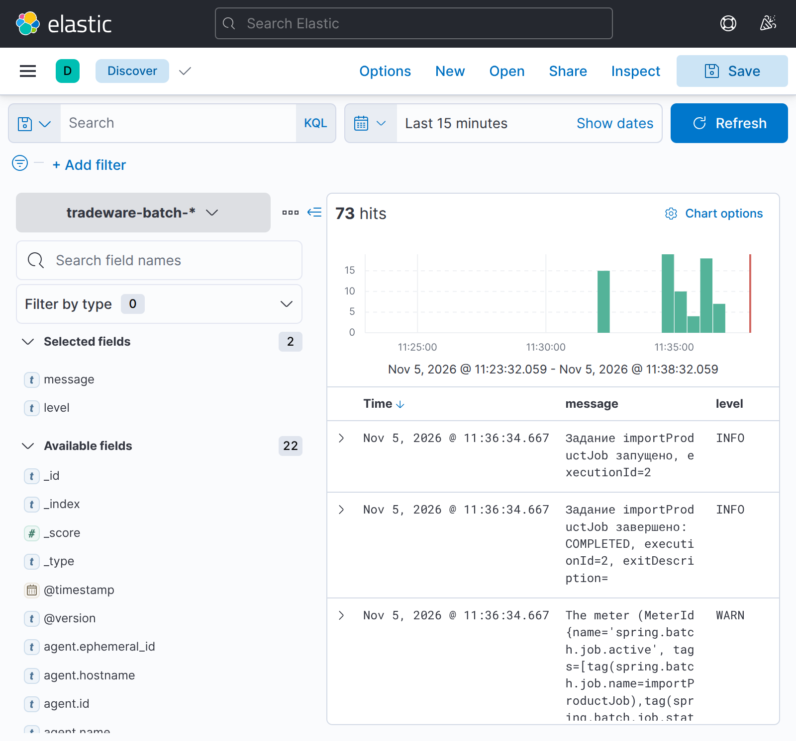
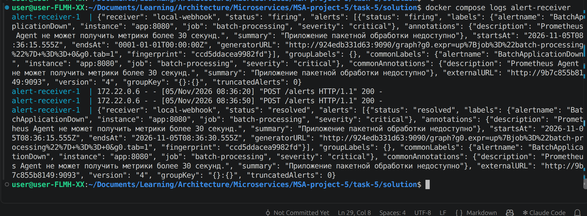

# Задание 5: мониторинг и логирование

- [Обоснование метрик, оповещений и логирования](observability.md)
- [Исходник диаграммы PlantUML](architecture.puml)
- [Приложение, Compose и инструкция по запуску](../solution/README.md)

## Архитектура



## Проверка локального запуска

- Задание завершилось со статусом `COMPLETED`, в PostgreSQL записаны пять товаров.
- Prometheus Agent передал метрики в Prometheus; Grafana отображает дашборд.
- Логи приложения прошли через Filebeat и Logstash в Elasticsearch и отображаются в Kibana Discover.
- При остановке приложения правило `BatchApplicationDown` сработало; Alertmanager доставил событие локальному webhook-приёмнику. Правило `BatchJobFailed` настроено, но его 

### Grafana




### Kibana Discover



### Локальный webhook-приёмник

Сервис `alert-receiver` принимает сообщения Alertmanager и выводит их в журнал контейнера. Ниже — снимок форматированного JSON из фактического вывода `docker compose logs alert-receiver`: видны уведомления о срабатывании (`firing`) и восстановлении (`resolved`) приложения.



Посмотреть журнал самостоятельно из каталога `task-5/solution`:

```bash
docker compose logs alert-receiver
```

Диаграмма показывает локальный POC. Для перегенерации изображения при установленном PlantUML:

```bash
plantuml -charset UTF-8 architecture.puml
```
