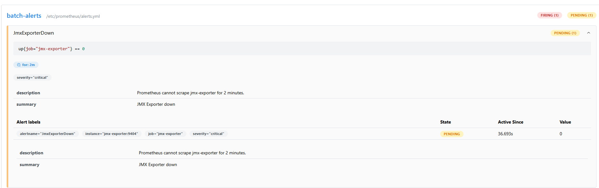
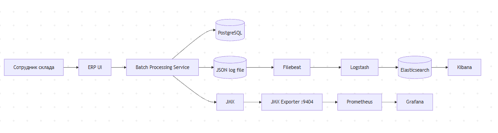
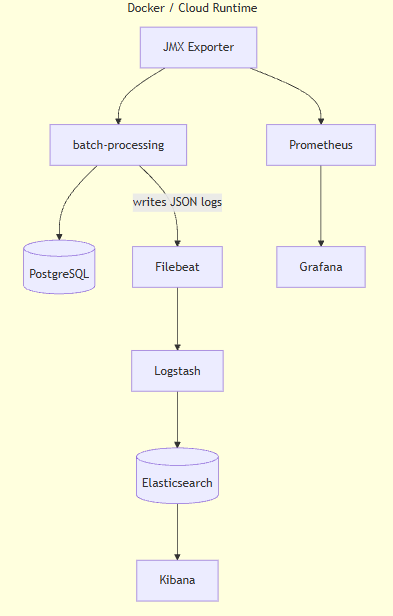
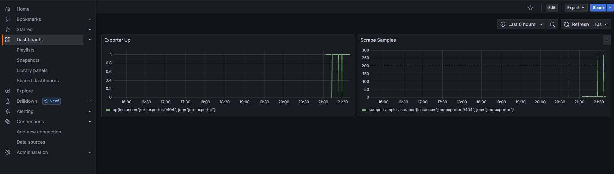
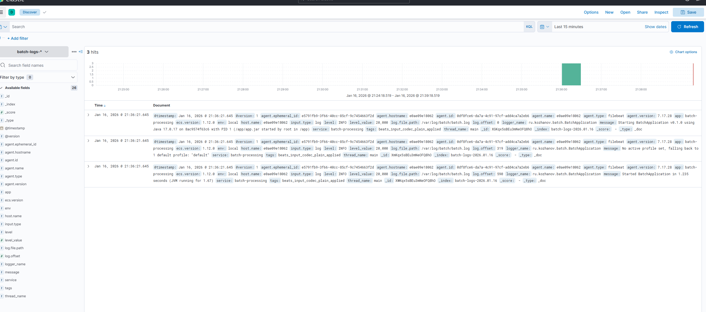

# Task5 — Обоснование мониторинга, логирования и оповещения

## Зачем это нужно TradeWare

В пиковые периоды обработка файлов (batch/ETL) перегружает систему: отчёты «висят», обновления идут с задержками, трудно найти причину сбоев, потому что нет централизованных метрик и логов.
Цель — получить наблюдаемость (observability) ETL-процессов: видеть производительность, ошибки и деградации, быстро диагностировать проблемы.

---

## Компоненты решения

### Prometheus
Система сбора и хранения метрик временных рядов. В нашем стенде Prometheus опрашивает (scrape) JMX Exporter и сохраняет метрики JVM и приложения.

**Польза:** единая “лента времени” для анализа — видно деградации, всплески ошибок, рост времени обработки и проблемные периоды.

### JMX Exporter (Prometheus JMX)
Промежуточный компонент, который читает метрики из JMX (Java-приложения) и отдаёт их в формате Prometheus (/metrics).

**Польза:** стандартный и cloud-ready способ снимать JVM/JMX метрики без внедрения кастомных endpoint’ов.

### Grafana
Визуализация метрик. Использует Prometheus как datasource, отображает дашборды состояния сервисов и производительности.

**Польза:** удобные дашборды для операторов/разработчиков, единый интерфейс “здоровья” системы.

### Filebeat
Лёгкий агент доставки логов. Читает структурированные JSON-логи приложения из файла (shared volume) и отправляет их в Logstash.

**Польза:** централизованный сбор логов без нагрузки на приложение и без «ручного копания» на VM/контейнере.

### Logstash
Процессор логов. Принимает события от Filebeat, при необходимости фильтрует/обогащает и пишет в Elasticsearch.

**Польза:** единая точка нормализации логов, удобно расширять пайплайн (маскировать PII, добавлять теги и т.д.).

### Elasticsearch + Kibana
- Elasticsearch индексирует и хранит логи.
- Kibana даёт поиск и фильтрацию по полям.

**Польза:** быстро найти конкретный запуск job, ошибку шага (step) и контекст по времени.

---

## Какие метрики собираем и почему

### Базовые (SRE-уровень)
1) **up** (доступность экспортера): показывает “жив ли сбор метрик”.
2) **scrape_samples_scraped / scrape_duration_seconds**: показывает, что метрики реально собираются и нет проблем с экспортом.

### JVM (на проде обязательно)
1) **heap/non-heap memory usage**: риск OOM, утечки памяти.
2) **GC pause**: латентность и деградации.
3) **CPU / threads**: зависания, рост потоков, saturation.

### Batch (цель на прод)
1) **job/step duration**: соблюдаем SLA (например, отчёт 2000 строк <= 30 сек).
2) **job failures count**: качество данных/стабильность интеграций.
3) **read/write/skip/retry counts**: где узкое место — чтение, обработка, запись в БД.

> В POC мы гарантированно демонстрируем доступность мониторинга (exporter up + сбор метрик),
> а batch-метрики расширяем по мере взросления решения (в следующих спринтах/задачах можно включить более точные binders).

---

## Логирование: какие поля и зачем

Логи пишутся в JSON, чтобы они были:
- машинно-парсируемыми
- фильтруемыми по полям в Kibana
- пригодными для алертов и аналитики

Рекомендуемые поля:
- `@timestamp` — время
- `level` — уровень
- `service` — имя сервиса (`batch-processing`)
- `job`, `step` — чтобы быстро группировать события по ETL
- `message` + `exception`/`stacktrace` — диагностика ошибок
- `runId`/`jobExecutionId` — корреляция одного запуска

---

## Оповещения (alerts)

Оповещения реализованы в Prometheus через alert rules:
1) **JmxExporterDown** — критично: мониторинг “ослеп”.
2) **NoScrapesFromExporter** — предупреждение: метрики не поступают (возможна деградация/зависание).

На проде это обычно дополняется доставкой в Slack/Email через Alertmanager или Grafana Alerting.
В текущем POC достаточно показать, что правила работают (Prometheus UI -> Alerts).

---

## Итог

В результате внедрения:
- есть метрики и дашборды для наблюдения за состоянием
- есть алерты на ключевые сбои мониторинга
- есть централизованные логи в Kibana для диагностики batch-процессов

Это снижает время поиска причин инцидентов и повышает надёжность ETL при росте нагрузки.

