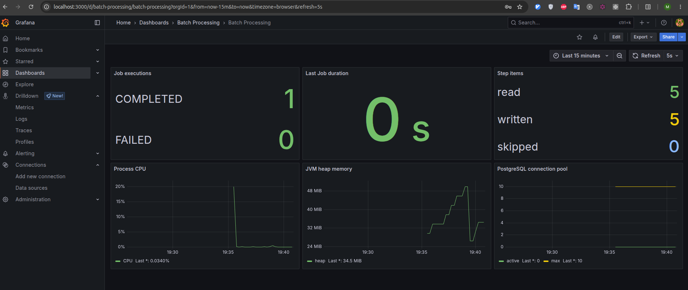
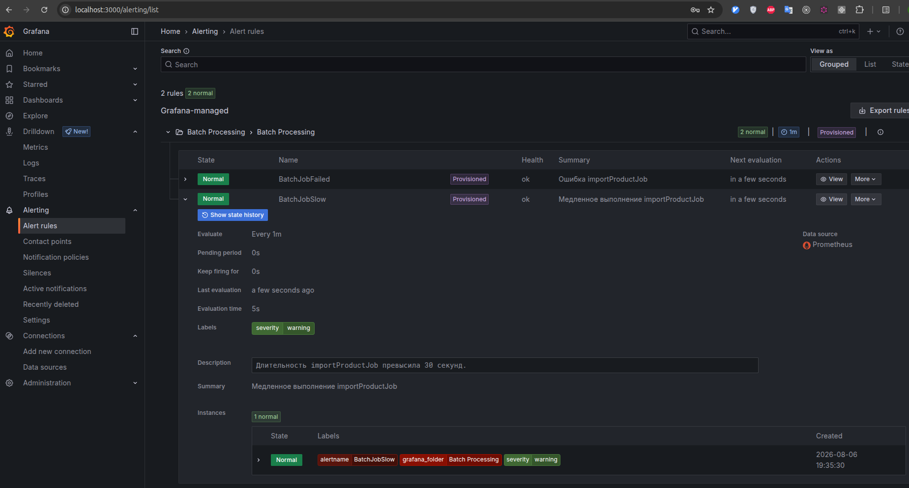
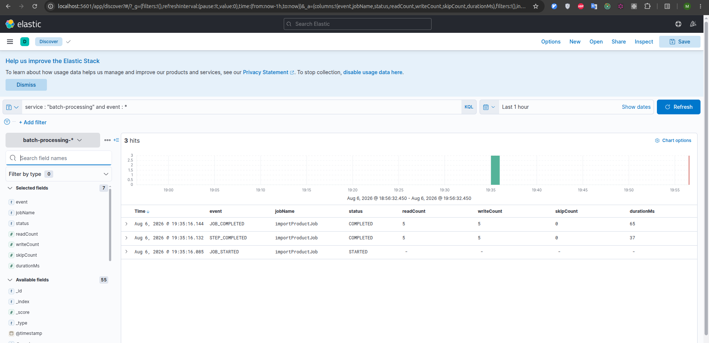
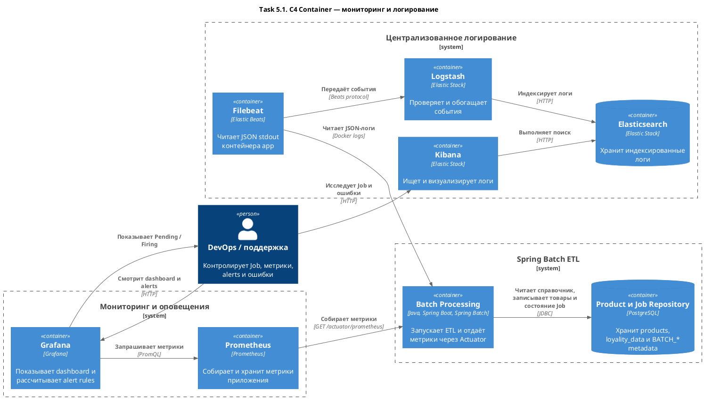

# Task 5. Мониторинг, оповещения и логирование

## Решение

Spring Batch-приложение становится долгоживущим сервисом. Job продолжает запускаться при старте, но после его завершения приложение остаётся доступным для сбора метрик через `/actuator/prometheus`. Автоматический запуск будет отключён в Task 6, когда появится API.

```text
Spring Batch ──metrics──► Prometheus ──► Grafana ──► Alerts
      │
      └──JSON stdout──► Filebeat ──► Logstash ──► Elasticsearch ──► Kibana
```

### Метрики

| Метрика | Тип и labels | Назначение |
|---|---|---|
| `batch_job_executions_total` | Counter: `job_name`, `status` | Количество успешных и ошибочных Job |
| `batch_job_duration_seconds` | Timer: `job_name`, `status` | Длительность Job и контроль требования 30 секунд |
| `batch_step_items_read_total` | Counter: `job_name`, `step_name` | Количество прочитанных строк |
| `batch_step_items_written_total` | Counter: `job_name`, `step_name` | Количество записанных строк |
| `batch_step_items_skipped_total` | Counter: `job_name`, `step_name` | Потерянные или пропущенные строки |
| `jvm_memory_used_bytes` | Gauge: `area` | Использование памяти JVM |
| `process_cpu_usage` | Gauge | Нагрузка приложения на CPU |
| `hikaricp_connections_active` и `hikaricp_connections_max` | Gauge | Нагрузка на пул соединений PostgreSQL |

В labels не добавляются `runId`, `fileId` и идентификаторы товаров: это создаст высокую кардинальность. Эти значения сохраняются в логах.

Grafana dashboard должен показывать:

- успешные и ошибочные Job;
- длительность последнего Job;
- прочитанные, записанные и пропущенные строки;
- CPU и память JVM;
- активные и доступные соединения PostgreSQL.

### Логирование

Приложение пишет структурированный JSON в `stdout`. Прямая отправка логов из Java в Elasticsearch не используется: временная недоступность ELK не должна останавливать batch-обработку.

| Событие | Когда записывается |
|---|---|
| `JOB_STARTED` | Перед запуском Job |
| `STEP_COMPLETED` | После завершения Step |
| `JOB_COMPLETED` | После успешного завершения Job |
| `JOB_FAILED` | После ошибки Job |

Поля лога:

- `service`, `event`, `timestamp`, `level`;
- `jobName`, `jobExecutionId`, `runId`, `stepName`, `status`;
- `readCount`, `writeCount`, `skipCount`, `durationMs`;
- для ошибки: `errorType`, `errorMessage`, `stackTrace`.

Пароли, содержимое CSV и данные товаров не логируются.

### Доставка и хранение логов

1. Docker сохраняет JSON-логи контейнера приложения.
2. Filebeat читает только контейнер `app` и добавляет Docker metadata.
3. Logstash проверяет JSON и добавляет служебные поля.
4. Elasticsearch сохраняет события в индекс `batch-processing-YYYY.MM.dd`.
5. Kibana используется для поиска по Job, статусу и типу события.

Filebeat отделяет приложение от ELK и может продолжить чтение после временной недоступности Logstash. Для облачной среды тот же JSON-формат можно отправлять в управляемое хранилище логов.

### Оповещения

Используется Grafana Alerting с Prometheus datasource. Отдельный Alertmanager для локального POC не нужен.

| Alert | PromQL | Условие |
|---|---|---|
| `BatchJobFailed` | `increase(batch_job_executions_total{job_name="importProductJob",status="FAILED"}[5m]) > 0` | За последние 5 минут завершился ошибочный Job |
| `BatchJobSlow` | `batch_job_duration_seconds_max{job_name="importProductJob"} > 30` | Job превысил допустимые 30 секунд |

Состояния `Pending` и `Firing` отображаются в Grafana. В production к этим правилам подключается корпоративный email, Slack или PagerDuty contact point.

## Реализация

- Spring Boot Actuator и Micrometer публикуют метрики через `/actuator/prometheus`.
- `BatchObservabilityListener` регистрирует Job/Step metrics и JSON-события.
- Docker Compose запускает приложение, PostgreSQL, Prometheus, Grafana и ELK.
- Grafana автоматически загружает dashboard и два alert rules.
- Filebeat читает только логи контейнера `batch-processing` и передаёт их через Logstash в Elasticsearch.

Команды запуска и проверки описаны в [INSTRUCTIONS.md](INSTRUCTIONS.md).

## Демонстрация

### Grafana dashboard



### Grafana alerts



### Логи в Kibana



## C4 Container



Диаграмма сфокусирована на мониторинге и логировании Spring Batch-приложения. Бизнес-компоненты, которые не меняются после Task 4, повторно не показаны.
