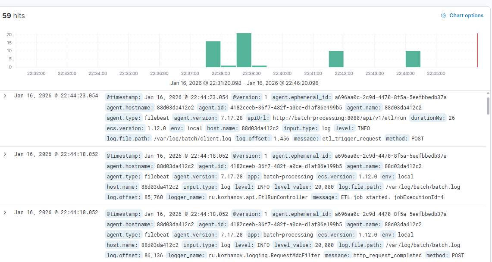

# Код в задание 5
## Лог обработки запроса

## Вызов запроса
docker run --rm `--network initial_default ` -e API_URL="http://batch-processing:8080/api/v1/etl/run" ` -v initial_batch-logs:/var/log/batch ` etl-client:0.1
## Логи из кибаны
