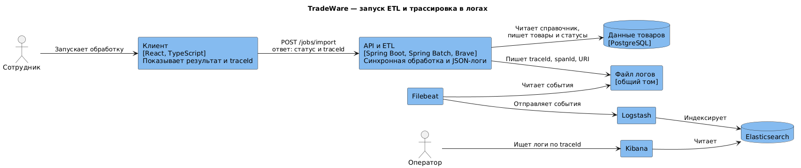
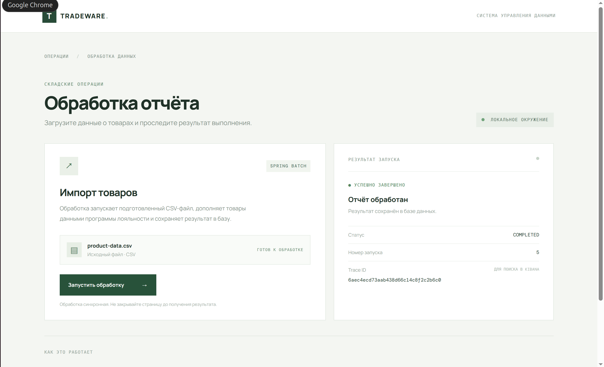
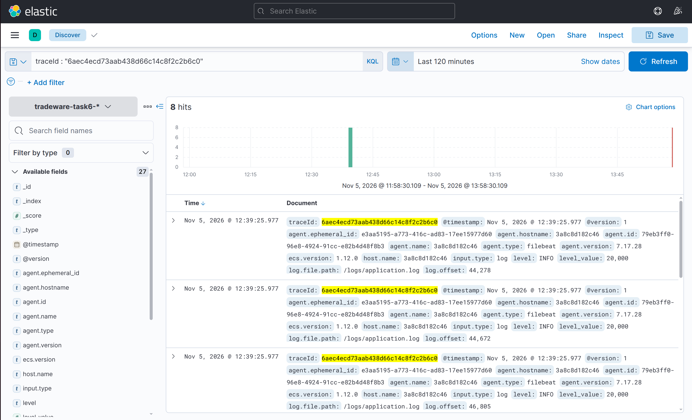

# Задание 6: запуск ETL и трассировка запросов

[Инструкция по запуску и проверке](../solution/README.md) · [Обоснование решения](tracing.md)

Приложение запускает Spring Batch-задачу только по HTTP-запросу. React-клиент ожидает синхронного результата и показывает `traceId`; события HTTP-запроса и обработки можно найти по нему в Kibana.

## Архитектура

[Исходник диаграммы PlantUML](architecture.puml).

## Проверка

- После запуска приложения, до вызова API, таблица `products` оставалась пустой.
- Вызов из React завершился со статусом `COMPLETED`; тот же `traceId` найден в логах HTTP-запроса и задания в Kibana, вместе с `spanId` и `/jobs/import`.
- Отдельно проверена передача W3C `traceparent`: сервер продолжил переданный `traceId`.
- При недоступном CSV API вернул HTTP 500, статус `FAILED` и `traceId`. После повторных успешных запусков в таблице осталось пять товаров.

### Клиент

### Логи в Kibana

На снимке найден тот же `traceId`, который показан клиентом. У вложенной операции задания свой `spanId`.

