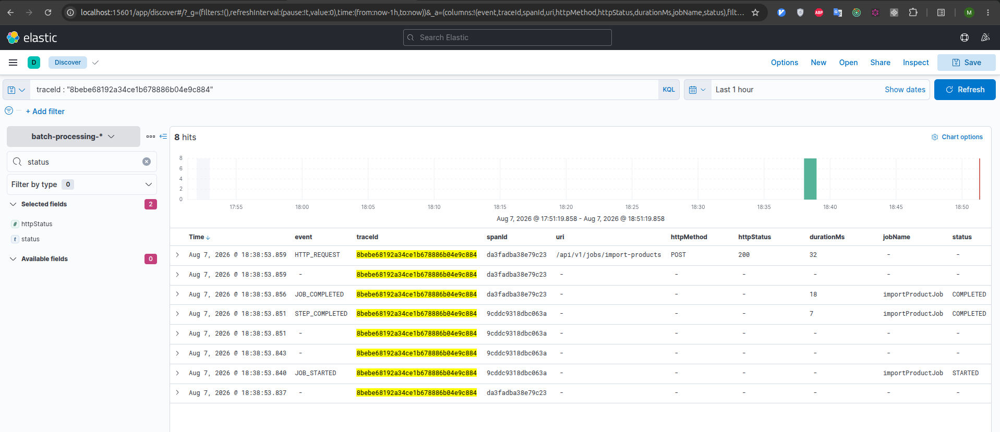

# Task 6. Трейсинг API-запроса

## Решение

Spring Batch Job запускается только запросом:

```text
POST /api/v1/jobs/import-products
```

Автоматический запуск отключён через `spring.batch.job.enabled=false`. Java-клиент передаёт стандартный заголовок W3C `traceparent`, а Spring создаёт серверный span и сохраняет его контекст в MDC.

```text
Java client ──traceparent──► API ──► Spring Batch Job
                                │
                                └──JSON logs──► Filebeat ──► Logstash ──► Elasticsearch ──► Kibana
```

Успешный ответ содержит идентификатор Job и `traceId`:

```json
{
  "jobExecutionId": 1,
  "jobName": "importProductJob",
  "status": "COMPLETED",
  "traceId": "0123456789abcdef0123456789abcdef"
}
```

## Трейсинг

Используются Micrometer Tracing и Brave. Они встроены в наблюдаемость Spring Boot, понимают W3C Trace Context и автоматически добавляют `traceId` и `spanId` в MDC. Отдельный Zipkin или Jaeger не нужен: по условию trace-контекст исследуется в ELK.

| Поле | Назначение |
|---|---|
| `traceId` | Связывает API-запрос и все события запущенного Job |
| `spanId` | Идентифицирует серверную операцию внутри trace |
| `uri` | Показывает вызванный endpoint |

`HttpTraceLoggingFilter` создаёт событие `HTTP_REQUEST` с URI, HTTP-методом, статусом и длительностью. `logback-spring.xml` добавляет MDC-поля в JSON. События `JOB_STARTED`, `STEP_COMPLETED` и `JOB_COMPLETED` выполняются синхронно и получают тот же `traceId`.

Filebeat читает JSON-логи контейнера приложения, Logstash обогащает их, а Elasticsearch сохраняет в `batch-processing-*`.

Команды запуска и проверка результата находятся в [INSTRUCTIONS.md](INSTRUCTIONS.md).

## Демонстрация


